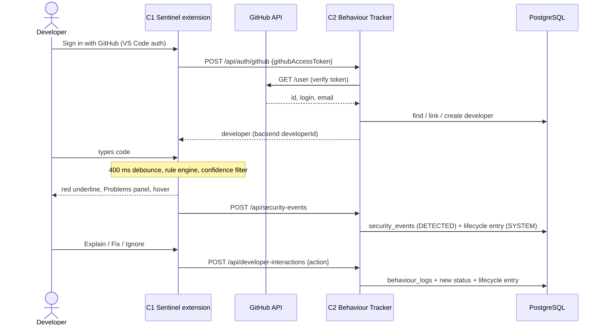
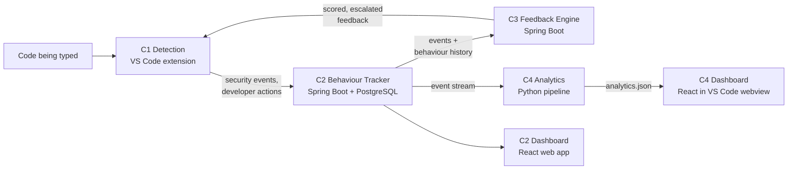
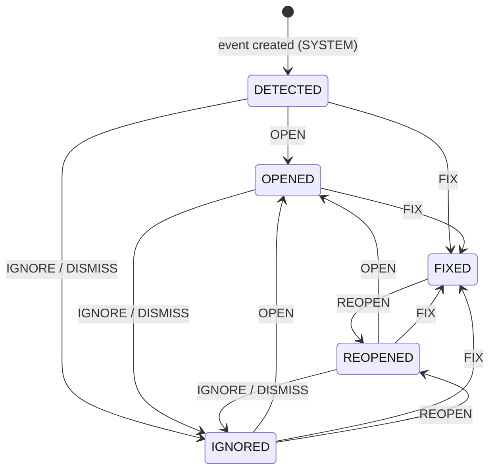
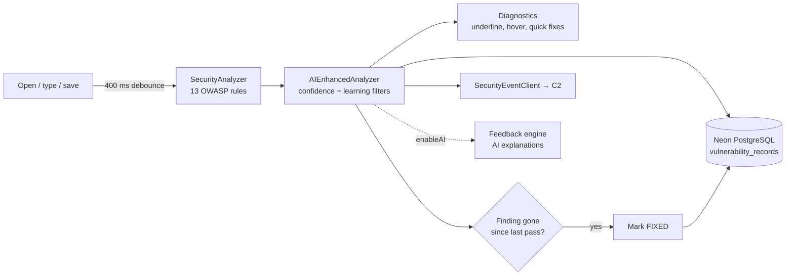

# Sentinel

**Real-Time Intelligent Security Monitoring Tool with Developer Behaviour Analysis**
Project J26-IT-394 · IT4010 Research Project, 2026 · Specialisation: Information Technology ·
Research group: Information Assurance & Security (IAS)

A developer writes code in VS Code. Sentinel flags insecure patterns such as SQL injection,
cross-site scripting and hardcoded secrets on the line where they appear, while the code is
being typed. It then records what the developer does about each warning: fixes it, ignores
it, dismisses it, or lets the same mistake come back. From that history it raises or lowers
how strongly it warns each developer and shows how their security habits change over time.

The research question is whether real-time, behaviour-aware security feedback leads to
measurably better secure-coding behaviour over time.

---

## Contents

1. [The problem](#1-the-problem)
2. [Existing solutions and their limits](#2-existing-solutions-and-their-limits)
3. [What Sentinel does](#3-what-sentinel-does)
4. [How the system works](#4-how-the-system-works)
5. [The four components](#5-the-four-components)
6. [Shared interface contracts](#6-shared-interface-contracts)
7. [Data, privacy and ethics](#7-data-privacy-and-ethics)
8. [Technology stack](#8-technology-stack)
9. [Repository layout and branches](#9-repository-layout-and-branches)
10. [Getting started](#10-getting-started)
11. [Project status](#11-project-status)
12. [Team](#12-team)
13. [References](#13-references)

---

## 1. The problem

Software vulnerabilities remain a leading cause of cyberattacks, data breaches and financial
loss. Plenty of security testing tools exist, yet security flaws still go unresolved and
reach production. The tools are not the only gap. The people using them are another.

- **Alert fatigue.** Developers working to tight deadlines face many security warnings.
  Warnings get ignored and fixes get delayed.
- **Detection without understanding.** ML and Graph Neural Network detectors have improved
  how accurately vulnerable code is found. They say little about how developers *respond*
  to a warning.
- **Behaviour is not tracked.** IDE activity has been studied to understand general coding
  patterns, but security-specific behaviour has received little attention. That includes
  ignored warnings, repeated vulnerabilities and improvement over time.
- **No central view.** Security teams can see vulnerabilities but not the behaviour that
  keeps producing them, so they cannot give targeted guidance.
- **Generic feedback.** Existing feedback gives every developer the same advice, whatever
  their history.
- **Static dashboards.** Current dashboards report vulnerability counts and statistics.
  They give little support for behaviour analytics or risk prediction.

**Who is affected:** developers (repeated mistakes, noisy tooling), security and
engineering leads (recurring issues with no visible cause), and organisations (risk that
reaches production).

## 2. Existing solutions and their limits

| Approach | Examples | Limitation |
|---|---|---|
| Static analysis and security scanners | SonarQube, Snyk, Checkmarx, GitHub Advanced Security | Find and report weaknesses, but do not record how each developer responds to them. |
| ML / GNN vulnerability detectors | Structure-aware and heterogeneous GNN detectors; offline GNN plugins with LLM explanations | Improve detection accuracy; developer behaviour is out of scope. |
| IDE behaviour studies | 1000-hour industrial study of developer behaviour; eye-tracking + IDE action studies; cloud-IDE behaviour studies | Characterise general coding activity, not responses to security warnings. |
| Immediate in-IDE security feedback | Research prototypes for security-relevant code | Same message for every developer; no escalation from history. |
| Security dashboards | Vendor and research dashboards | Show vulnerability counts; little behaviour analytics or forecasting. |

None of these tracks ignored alerts, repeated mistakes, delayed fixes and long-term
improvement together, and none adapts its feedback to an individual developer.

## 3. What Sentinel does

Sentinel is four research components that form one pipeline: detection feeds tracking,
tracking informs feedback, and all three feed analytics.

| | Component | What it solves |
|---|---|---|
| **C1** | Real-Time Code Detection (Sentinel VS Code extension) | Finds insecure patterns across the OWASP Top 10 while code is written, shows them in the editor with a code-specific explanation and fix, detects when they are fixed, and turns every detection and developer action into a structured record. |
| **C2** | Developer Behaviour Tracker | The system's memory. Records each warning's full lifecycle and how the developer responded, and builds a behaviour summary and classification per developer. |
| **C3** | Intelligent Feedback Engine | The decision layer. Scores each issue's severity from the event and the developer's history, escalates warnings that keep being ignored, and attaches secure-coding guidance. |
| **C4** | Analytics and Dashboard | The research evidence layer. Measures improvement over time, forecasts behaviour, classifies developers into research risk profiles, runs correlation analysis and produces a research summary report. |

## 4. How the system works

### 4.1 A detection and a developer response



This is the integrated flow on `feature/component-2-backend-foundation`. On `hishen_dev`,
C1 also stores every finding and status change in its own Neon PostgreSQL database (see
[C1](#c1--real-time-code-detection-the-sentinel-vs-code-extension)).

### 4.2 The full pipeline



### 4.3 The vulnerability lifecycle (C2)

Every security event moves through a fixed set of statuses. Each developer action maps to a
target status, and only the transitions below are accepted.



### 4.4 Who talks to whom

| Component | Takes in | Gives out |
|---|---|---|
| **C1** | Source code as it is typed or scanned; developer clicks (Explain, Ignore) and code edits that remove a finding; GitHub sign-in | `SecurityFinding` objects with OWASP category; vulnerability records in Neon PostgreSQL; security events and developer actions sent to C2; requests to C3 for enriched feedback |
| **C2** | Security events and developer actions from C1; GitHub access token | Stored events, behaviour logs, lifecycle history; per-developer behaviour summary and classification |
| **C3** | A security event plus the developer's behaviour history | A severity score and level, adjusted for history, with a recommendation template |
| **C4** | A stream of events in the C4 event schema (today: simulated) | `analytics.json`: trends, forecasts, risk profiles, correlations, recommendations; research summary report |

## 5. The four components

### C1 · Real-Time Code Detection: the Sentinel VS Code Extension

**Owner:** M H S Perera (IT23163218) · **Folder:** [`sentinel/`](sentinel/) ·
**Branches:** `hishen_dev` (latest), `main` · **Runs in:** VS Code Extension Host (no port)

**Problem.** Most security checks run after code is written: in CI, in review or in a
scheduled scan. By then the developer has moved on, and the warning arrives out of context.

**Objective.** Monitor code changes in real time, detect insecure patterns across the OWASP
Top 10 (2021), show warnings in the editor, notice when the developer fixes them, and store
every detection and response as structured data that the rest of the system builds on.

**Novelty.** Detection happens *while the developer types*, not after development. A finding
is marked `FIXED` only when the insecure code is actually gone from the editor, not when a
button is clicked. Every warning and every response becomes a structured record, so C1 is
both the user-facing tool and the research data source.

**How it works.**



1. **Trigger.** The extension activates on `onStartupFinished`. A file is analysed when it is
   opened, after every change (debounced by `sentinel.debounceMs`, 400 ms by default), and
   immediately on save.
2. **Rule engine.** [`SecurityAnalyzer`](sentinel/src/analyzer/securityAnalyzer.ts) runs 13
   rules, at least one per OWASP Top 10 category. A rule that throws is logged and skipped,
   so one bad rule never stops the analysis. Findings are sorted by severity, then line.

   | OWASP 2021 | Rule | Patterns | Covers |
   |---|---|---|---|
   | A01 Broken Access Control | [`brokenAccessControlRule.ts`](sentinel/src/rules/brokenAccessControlRule.ts) | 42 + 3 sinks | Path traversal and zip slip, open redirects, permissive CORS, missing CSRF protection, roles taken from the request, IDOR, unprotected routes, mass assignment |
   | A02 Cryptographic Failures | [`cryptographicFailuresRule.ts`](sentinel/src/rules/cryptographicFailuresRule.ts) | 34 | Fast hashes (MD5/SHA-1) for passwords, weak ciphers (DES/RC4/ECB), hardcoded keys, static IVs, `Math.random()` tokens, disabled TLS verification, small RSA keys, low bcrypt cost, cleartext HTTP |
   | A03 Injection (SQL) | [`sqlInjectionRule.ts`](sentinel/src/rules/sqlInjectionRule.ts) | 17 | String-concatenated `SELECT`/`INSERT`/`UPDATE`/`DELETE`, `LIKE` and `ORDER BY` injection, template literals, stored-procedure building |
   | A03 Injection (XSS) | [`xssRule.ts`](sentinel/src/rules/xssRule.ts) | 18 | `innerHTML`/`outerHTML`/`insertAdjacentHTML`, `document.write`, `eval`, `new Function`, React `dangerouslySetInnerHTML`, Angular `bypassSecurityTrust*`, server templates |
   | A03 Injection (other) | [`injectionRule.ts`](sentinel/src/rules/injectionRule.ts) | 34 + 9 sinks | OS command and code `eval`, NoSQL, LDAP, XPath, server-side template, raw ORM/SQL APIs, GitHub Actions script injection |
   | A04 Insecure Design | [`insecureDesignRule.ts`](sentinel/src/rules/insecureDesignRule.ts) | 16 + 3 sinks | Unrestricted uploads, missing rate limits, auth-bypass and backdoor flags, trusting client-side prices or hidden fields, ReDoS from user regex, unbounded limits |
   | A05 Security Misconfiguration | [`securityMisconfigurationRule.ts`](sentinel/src/rules/securityMisconfigurationRule.ts) | 45 | Debug mode, stack traces in responses, XXE, insecure cookies, disabled security headers or CSP; Docker root user, privileged containers, open IaC ingress, public storage and IAM wildcards in YAML, Dockerfile and Terraform |
   | A06 Vulnerable Components | [`vulnerableComponentsRule.ts`](sentinel/src/rules/vulnerableComponentsRule.ts) | 6 + manifest checks | Known-bad packages (`node-serialize`, `event-stream`, …), 20 libraries below a minimum safe version (lodash, log4j, jackson-databind, …), unpinned versions, end-of-life runtimes, in `package.json`, `requirements.txt`, `pom.xml`, `go.mod` and other manifests |
   | A07 Auth Failures (secrets) | [`hardcodedSecretRule.ts`](sentinel/src/rules/hardcodedSecretRule.ts) | 22 | API keys, passwords, AWS/OpenAI/Anthropic/Google keys, cloud, CI/CD, database and payment tokens, private keys. Vendor-specific patterns are CRITICAL, generic ones HIGH. Secrets are redacted in snippets |
   | A07 Auth Failures (design) | [`authFailuresRule.ts`](sentinel/src/rules/authFailuresRule.ts) | 18 | JWT `alg: none`, `jwt.decode` without verification, tokens without expiry, weak JWT/session secrets, plaintext password comparison, default credentials, no session regeneration |
   | A08 Integrity Failures | [`integrityFailuresRule.ts`](sentinel/src/rules/integrityFailuresRule.ts) | 18 + 2 sinks | Unsafe deserialisation (pickle, YAML, `ObjectInputStream`, `BinaryFormatter`, `unserialize`, `node-serialize`), `curl \| sh` installs, scripts without SRI, unpinned GitHub Actions |
   | A09 Logging Failures | [`loggingFailuresRule.ts`](sentinel/src/rules/loggingFailuresRule.ts) | 13 + 1 sink | Passwords or raw request bodies in logs, empty `catch` blocks, auth handlers that log nothing, log injection |
   | A10 SSRF | [`ssrfRule.ts`](sentinel/src/rules/ssrfRule.ts) | 14 + 6 sinks | Outbound requests on user-supplied URLs in JS, Python, Java, PHP, C#, Go and Ruby; cloud metadata endpoints |

   In total: 297 regular-expression patterns and 24 taint sinks.
3. **Shared pattern engine.** The ten newer rules only declare *what* to look for;
   [`patternEngine.ts`](sentinel/src/rules/patternEngine.ts) handles *how*:
   - per-pattern language and file-name gating, so a rule can scan `package.json`,
     `Dockerfile` or YAML as well as source code;
   - skipping comment lines;
   - mitigation checks on the line, in nearby context or anywhere in the file
     (`safeIfLine`, `safeIfContext`, `safeIfFile`), so code that is already safe is not
     flagged;
   - **lightweight taint tracking**: variables assigned from user input (`req.body`,
     `req.query`, `request.args`, `$_GET`, `getParameter`, …) are collected, and a finding is
     raised when one of them reaches a dangerous sink, for example
     `const target = req.query.url; axios.get(target);`;
   - one finding per line and type (highest confidence wins), and secret redaction.
4. **Stable finding ids.** [`computeFindingId`](sentinel/src/analyzer/types.ts) hashes the
   file, type, rule and normalised snippet (SHA-256). The same vulnerable line keeps the same
   id across keystrokes and scans, so re-analysing does not create duplicates or false
   "fixed" events.
5. **Confidence and learning.** Each finding carries a confidence from 0.0 to 1.0, raised by
   nearby context keywords. [`AIEnhancedAnalyzer`](sentinel/src/ai/aiEnhancedAnalyzer.ts)
   then filters the raw findings per developer using
   [`DeveloperLearningStore`](sentinel/src/ai/developerLearningStore.ts):
   - findings below `sentinel.minConfidence` (0.7 by default) are hidden;
   - a vulnerability type is suppressed after 3 false-positive reports from that developer;
   - snippets already marked as false positives are skipped (last 100 hashes kept);
   - per-rule confidence goes up when the developer fixes and down when they ignore.

   With `sentinel.enableAI` on, findings are also sent to the feedback engine
   (`POST {sentinel.ifeUrl}/api/feedback/request`). It returns AI explanations, a
   personalised fix and an escalation level (`REPEATED`, `PERSISTENT`, `CRITICAL_PATTERN`),
   shown as a notification. The underline never waits for this call.
6. **Presentation.** [`DiagnosticManager`](sentinel/src/diagnostics/diagnosticManager.ts)
   shows each finding as:
   - a red underline and an entry in the Problems panel, tagged with its OWASP category;
   - a hover with the explanation, attack scenario and secure replacement code, plus
     **Full AI Explanation** and **Ignore Warning** links;
   - a lightbulb with **View Fix Suggestion & Secure Example** and **Ignore warning for this
     line**.

   [`ContextualExplainer`](sentinel/src/diagnostics/contextualExplainer.ts) builds the
   explanation from the developer's own code: a headline, why it is dangerous, a concrete
   attack scenario, the vulnerable code, a transformed fixed version and what the fix does.
   Generic text per type comes from
   [`vulnerabilityMetadata.ts`](sentinel/src/diagnostics/vulnerabilityMetadata.ts).
   HIGH and CRITICAL findings are also echoed to a "Sentinel Security Alert" terminal.
7. **Real-time fix detection.** There is no "auto-fix" button. On every pass, findings that
   were present before but are now gone are recorded as `FIXED`: in memory, in the learning
   store, as an event to C2, and in the database (`autoDetectFixedFindingsInFile`). The
   status bar shows `✅ Sentinel: Fixed <type> at line <n>`.
8. **Workspace scan.** `Sentinel: Scan Entire Workspace & Sync Database` scans every
   `js, ts, jsx, tsx, py, java, cs, php, rb, go, json` file (skipping `node_modules`, `.git`,
   `out`, `dist`, `build`), fills the Problems panel and saves every finding to the database.
9. **Storage.** [`NeonDatabaseService`](sentinel/src/data/neonDatabaseService.ts) connects to
   Neon serverless PostgreSQL over SSL (`pg`), creates the tables on first run and seeds the
   initial users:

   | Table | Holds |
   |---|---|
   | `users` | Username, GitHub username and avatar, role, SHA-256 password hash, last login |
   | `vulnerability_records` | One row per finding: developer, session, shift, type, severity, confidence, file, line, snippet, `why_vulnerable`, `how_to_fix`, `fixed_code`, `attack_scenario`, status (`OPEN`, `FIXED`, `IGNORED`, `FALSE_POSITIVE`), `detected_at`, `fixed_at` |
   | `user_activity_logs` | Audit log of user actions (logins, ignores, fixes, admin changes) |
   | `sentinel_documents` | JSON documents by collection: projects, shifts, shift sessions, learning profiles |

   If the database cannot be reached, the extension keeps working with in-memory storage and
   logs that it is offline.
   [`DeveloperRecordStore`](sentinel/src/data/developerRecordStore.ts) writes each new
   finding with its contextual explanation, and
   [`ProjectStore`](sentinel/src/data/projectStore.ts) manages projects, shifts and shift
   sessions.
10. **Reporting to C2.** [`SecurityEventClient`](sentinel/src/events/securityEventClient.ts)
    sends each detection and developer action (`DETECTED`, `EXPLANATION_VIEWED`,
    `SECURE_EXAMPLE_VIEWED`, `IGNORED`, `FIXED`, …) to
    `POST {sentinel.backendUrl}/api/security-events`, batched every second. A failed send is
    retried up to 3 times with a 5-second timeout, then dropped so the editor is never
    blocked. See [known integration gaps](#11-project-status).
11. **Identity and roles.** [`AuthManager`](sentinel/src/auth/authManager.ts) offers two ways
    to sign in:
    - **GitHub OAuth** through VS Code's built-in auth provider (primary). The session is
      restored silently on activation; after an explicit sign-out the next sign-in forces a
      fresh GitHub session. New GitHub users become `developer`s.
    - **Username and password**, checked against SHA-256 hashes, for supervisors and
      administrators without GitHub.

    The developer id used for records is the GitHub username, then `sentinel.developerId`.
    There are three roles: `developer`, `supervisor` and `administrator`.
12. **In-editor dashboards** (webviews, opened from the status bar or the editor title bar):
    - [Login](sentinel/src/webview/loginView.ts): GitHub sign-in first, password second, with
      a [loading screen](sentinel/src/webview/loadingView.ts) while sign-in and data load.
    - [Developer](sentinel/src/webview/developerDashboard.ts): security score, live findings
      filtered by severity, the database vulnerability tracker (Open / Fixed / Ignored, fix
      progress), jump to line, start and end shift, shift reports.
    - [Supervisor](sentinel/src/webview/supervisorDashboard.ts): team overview, projects,
      shifts and assignments, per-developer reports, developer roster.
    - [Administrator](sentinel/src/webview/adminDashboard.ts): overview, analytics, system
      status (database online, ping), adding and removing users.

**Commands.** `Sentinel: Show Security Dashboard` · `Sentinel: Analyze Current File` ·
`Sentinel: Scan Entire Workspace & Sync Database` · `Sentinel: Show Output Channel`.

**Settings.**

| Setting | Default | Purpose |
|---|---|---|
| `sentinel.enabled` | `true` | Turn real-time analysis on or off |
| `sentinel.debounceMs` | `400` | Delay after a change before analysing (ms) |
| `sentinel.backendUrl` | `http://localhost:3000` | Behaviour tracker URL for security events (C2 runs on `8080`) |
| `sentinel.developerId` | `DEV001` | Fallback developer id when not signed in with GitHub |
| `sentinel.enableAI` | `false` | Send findings to the feedback engine for AI explanations and escalation |
| `sentinel.ifeUrl` | `http://localhost:4000` | Feedback engine URL |
| `sentinel.minConfidence` | `0.7` | Hide findings below this confidence |

Database connection settings come from `PGHOST`, `PGDATABASE`, `PGUSER`, `PGPASSWORD` and
`PGPORT`.

**Testing.**
- `npm test` ([`runTest.ts`](sentinel/src/test/runTest.ts)) runs 21 detection cases covering
  all ten OWASP categories in JavaScript, TypeScript, Python and config files. Current result:
  20 of 21 pass; case #14 (a hardcoded secret in `config.ts`) is not detected.
- [`verifyTop10RealTimeFix.ts`](sentinel/src/test/verifyTop10RealTimeFix.ts) checks detection,
  explanation generation and the `OPEN → FIXED` flow when vulnerable code is edited.
- [`verifyProgressConcept.ts`](sentinel/src/test/verifyProgressConcept.ts) checks the fix
  percentage (0% → 16.7% → 50% → 100% of 6 findings) and that stable ids cause no false fixes.
- [`test_project/`](test_project/) is a deliberately vulnerable Express app with examples for
  every OWASP category. `node test-all-rules.js` scans it, expects 38 findings across 10/10
  categories, generates explanations and verifies that all 38 are stored in the database.

**Tech stack.** TypeScript 5.4 · VS Code Extension API (engine ^1.85.0) · Neon serverless
PostgreSQL via `pg` 8 · `node-fetch` 3 · Node `crypto` (SHA-256) · ESLint 8 with
typescript-eslint 8 · `vsce` for packaging.

---

### C2 · Developer Behaviour Tracker

**Owner:** R S D Sulakshana (IT23249752) ·
**Folder:** [`component-2-behaviour-tracker/`](component-2-behaviour-tracker/) ·
**Branch:** `feature/component-2-backend-foundation` (older snapshot on `dev`) ·
**Ports:** API 8080, dashboard 5173

**Problem.** A warning is only half the data. Without a record of what the developer did
next, there is no way to tell a developer who fixes everything from one who dismisses every
SQL injection warning, or to see the same mistake return.

**Objective.** Receive security events from C1, store the alert type, file, line,
timestamp and the developer's response, track whether warnings are fixed, ignored or
repeated, and build behaviour summaries from that history.

**Novelty.** It records more than alerts. It models each vulnerability's lifecycle with
enforced status transitions and measures response times. From that it produces an
explainable behaviour classification per developer, which turns a linter into a research
instrument.

**Data model** (PostgreSQL; DDL in
[`schema.sql`](component-2-behaviour-tracker/backend/src/main/resources/schema.sql)):

| Table | Holds | Key columns |
|---|---|---|
| `developers` | One row per developer, linked to GitHub | `developer_identifier` (unique), `github_id` (unique), `github_username`, `email` |
| `security_events` | One row per detected vulnerability | `developer_id`, `vulnerability_type`, `severity`, `file_name`, `line_number`, `message`, `detected_at`, `current_status` |
| `behaviour_logs` | One row per developer action | `developer_id`, `security_event_id`, `action_type`, `timestamp`, `time_since_detection_seconds`, `session_id`, `source`, `context_metadata` |
| `vulnerability_lifecycle_history` | One row per status change | `security_event_id`, `previous_status`, `new_status`, `changed_at`, `changed_by` |

All tables have audit timestamps (JPA auditing) and indexes on the developer, event, time,
type, severity and status columns. Deleting a developer cascades to their events; deleting
an event sets its behaviour logs' event reference to null.

**Enums.**

| Enum | Values |
|---|---|
| `Severity` | `LOW`, `MEDIUM`, `HIGH`, `CRITICAL` |
| `BehaviourAction` | `OPEN`, `IGNORE`, `FIX`, `REOPEN`, `DISMISS` |
| `SecurityEventStatus` | `DETECTED`, `OPENED`, `IGNORED`, `REOPENED`, `FIXED` |

**How a developer action is processed**
([`DeveloperInteractionServiceImpl`](component-2-behaviour-tracker/backend/src/main/java/com/sentinel/tracker/service/impl/DeveloperInteractionServiceImpl.java)),
all in one transaction:

1. Load the developer, and load the security event with a **pessimistic write lock** so
   concurrent actions on the same event are serialised.
2. **Ownership check.** Only the developer who owns the event may act on it (`403`
   otherwise).
3. Map the action to a target status: `OPEN → OPENED`, `FIX → FIXED`,
   `IGNORE`/`DISMISS → IGNORED`, `REOPEN → REOPENED`.
4. **Validate the transition** against the lifecycle in [section 4.3](#43-the-vulnerability-lifecycle-c2).
   Any other change, including a repeat of the current status, is rejected with `409` and
   nothing is stored.
5. Compute `time_since_detection_seconds`, save the behaviour log, update the event's
   status and append a lifecycle history entry with `changed_by` = the developer.

Creating a security event writes its first lifecycle entry (`null → DETECTED`, changed by
`SYSTEM`) in the same transaction.

**Behaviour analysis**
([`BehaviourAnalysisServiceImpl`](component-2-behaviour-tracker/backend/src/main/java/com/sentinel/tracker/service/impl/BehaviourAnalysisServiceImpl.java)).
`GET /api/developer-behaviour/{developerId}` returns:

- **Counts:** opened, fixed, ignored, dismissed, reopened. Each counts *distinct* events
  owned by the developer, so repeated actions on one event count once and every rate stays
  within 0–100%.
- **Rates** (percent of the developer's events, one decimal):
  - fix rate;
  - ignore rate (ignored or dismissed, counted once per event);
  - reopen rate;
  - high-severity fix rate over HIGH and CRITICAL events (`null` if the developer has
    none).
- **Average response time** in seconds, and the **repeated vulnerability count** (the
  number of vulnerability types that appear more than once).
- **Classification**, from explainable rules applied in this order:

  | Classification | Rule |
  |---|---|
  | `INSUFFICIENT_DATA` | fewer than 3 events or fewer than 3 actions |
  | `SECURITY_RESPONSIVE` | fix rate ≥ 80%, high-severity fix rate ≥ 80% (or not applicable), ignore rate < 20% |
  | `SECURITY_AT_RISK` | ignore rate ≥ 40%, or high-severity fix rate < 50% |
  | `RECURRING_SECURITY_BEHAVIOUR` | reopen rate ≥ 30%, or 3 or more repeated vulnerability types |
  | `SECURITY_NEUTRAL` | none of the above |

**GitHub sign-in** ([`GitHubAuthServiceImpl`](component-2-behaviour-tracker/backend/src/main/java/com/sentinel/tracker/service/impl/GitHubAuthServiceImpl.java)).
The client sends only a GitHub access token. C2 verifies it with GitHub's `GET /user` and
takes the id, login and email from that response, never from the client. It then looks the
developer up in three steps:

1. Find the developer by verified GitHub id, and refresh their profile.
2. Otherwise, link a legacy record whose identifier equals the login. If that record is
   already linked to a different GitHub account, return `409`.
3. Otherwise, create a new developer.

No database connection is held while waiting for GitHub.

**REST API** (Swagger UI at `/swagger-ui.html`, OpenAPI JSON at `/api-docs`, health check
`GET /`):

| Method | Path | Purpose |
|---|---|---|
| POST | `/api/auth/github` | Sign in with a GitHub token; find, link or create the developer |
| POST · GET | `/api/developers` | Create · list developers |
| GET | `/api/developers/{id}` | Get one developer |
| POST · GET | `/api/security-events` | Record a detection · list all |
| GET | `/api/security-events/{id}` | Get one event |
| GET | `/api/security-events/developer/{developerId}` | Events for a developer |
| POST · GET | `/api/developer-interactions` | Record an action (the single write path) · list all |
| GET | `/api/developer-interactions/{id}` | Get one interaction |
| GET | `/api/developer-interactions/developer/{developerId}` | Interactions by developer |
| GET | `/api/developer-interactions/security-event/{securityEventId}` | Interactions on an event |
| GET | `/api/behaviour-logs`, `/{id}`, `/developer/{developerId}` | Read behaviour logs (same table as interactions) |
| POST | `/api/behaviour-logs` | **Deprecated.** Same logic as interactions; responds with `Deprecation: true` and a `Link` header |
| GET | `/api/lifecycle-history/security-event/{securityEventId}` | Status history of an event |
| GET | `/api/developer-behaviour/{developerId}` | Behaviour summary and classification |

**Errors** go through one `GlobalExceptionHandler` and return an `ApiErrorResponse`:

| Status | Meaning |
|---|---|
| `400` | Validation failed, or the GitHub token is missing |
| `401` | GitHub rejected the token |
| `403` | The developer does not own the event |
| `404` | Resource not found |
| `409` | Duplicate resource, invalid lifecycle transition, or GitHub account conflict |
| `502` | The GitHub API is unavailable |
| `500` | Unexpected server error |

**Dashboard** ([`frontend/`](component-2-behaviour-tracker/frontend/)). A React web app
for exploring the tracker's data. In development, Vite proxies `/api` to
`http://localhost:8080`. Pages:

| Route | Page |
|---|---|
| `/` | Home, a list of developers |
| `/developers/:developerId` | Developer profile |
| `/developers/:developerId/security-events` | Security events |
| `/developers/:developerId/lifecycle` | Lifecycle timeline |
| `/developers/:developerId/behaviour` | Behaviour analysis |

The app supports light and dark themes.

**Tests.** 93 test methods in 11 classes, covering repositories, services, controllers,
GitHub auth (with a mocked GitHub client), lifecycle transitions and behaviour analysis.
They run against H2 in memory, so no PostgreSQL is needed.

**Tech stack.**
- **Backend:** Java 17 · Spring Boot 3.3.5 (Web, Data JPA, Validation) · Hibernate ·
  PostgreSQL 14+ via HikariCP · springdoc-openapi 2.6.0 · Lombok · Maven · JUnit 5,
  Spring Boot Test and H2 2.1 for tests.
- **Dashboard:** React 19 · React Router 7 · Axios · TypeScript 5.9 · Vite 6.

Full backend detail is in [`component-2-behaviour-tracker/backend/README.md`](component-2-behaviour-tracker/backend/README.md).

---

### C3 · Intelligent Feedback Engine

**Owner:** D R Pathirage (IT23202122) · **Folder:** `component-3-feedback-engine/` ·
**Branch:** `Component-3` (initial setup on `main`) · **Port:** 8083

**Problem.** Static tools give every developer the same warning at the same strength. A
developer who has ignored the same SQL injection warning four times sees exactly what a
first-timer sees.

**Objective.** Receive security alerts and behaviour history, analyse each issue's type and
severity, strengthen the warning when the same mistake keeps happening, and return
personalised secure-coding recommendations in a clear form.

**Novelty.** Feedback adapts to repeated behaviour and risk level. For example, a first SQL
injection may get a MEDIUM warning with a suggested fix. The same issue ignored again and
again escalates to a stronger level with a firmer explanation and remediation guidance.

**Severity scoring**
([`SeverityScoringService`](https://github.com/Ruwaneke/J26-IT-394/blob/Component-3/component-3-feedback-engine/src/main/java/com/sentinel/feedback/scoring/SeverityScoringService.java)):

```
score = base(severity) + confidence adjustment + min(5 × earlier findings of the same type, 15)
score is clamped to 0–100, then banded
```

| Base severity | Base score | | Confidence | Adjustment | | Score | Level |
|---|---|---|---|---|---|---|---|
| INFO | 0 | | < 0.5 | −10 | | 0–19 | INFO |
| LOW | 20 | | 0.5–0.89 | 0 | | 20–39 | LOW |
| MEDIUM | 40 | | ≥ 0.9 | +10 | | 40–59 | MEDIUM |
| HIGH | 65 | | | | | 60–79 | HIGH |
| CRITICAL | 85 | | | | | 80–100 | CRITICAL |

A confidence outside 0.0–1.0 is rejected.

**Behaviour-aware escalation**
([`FeedbackEscalationService`](https://github.com/Ruwaneke/J26-IT-394/blob/Component-3/component-3-feedback-engine/src/main/java/com/sentinel/feedback/scoring/FeedbackEscalationService.java)):

- **2 or more earlier ignores:** the level goes up one step.
- **Otherwise, 3 or more earlier fixes:** the level goes down one step.
- Ignores are checked first. The level never goes below `INFO` or above `CRITICAL`.

**Recommendation templates**
([`RecommendationTemplateService`](https://github.com/Ruwaneke/J26-IT-394/blob/Component-3/component-3-feedback-engine/src/main/java/com/sentinel/feedback/recommendation/RecommendationTemplateService.java)).
Each vulnerability type has a title, guidance and a secure example:

| Type | Recommendation | Secure example |
|---|---|---|
| `SQL_INJECTION` | Use parameterised database queries | `connection.prepareStatement("SELECT * FROM users WHERE id = ?")` |
| `XSS` | Escape untrusted output | `element.textContent = untrustedValue;` |
| `HARDCODED_SECRET` | Move secrets to secure configuration | `System.getenv("API_KEY")` |
| `COMMAND_INJECTION` | Avoid shell interpretation of user input | `new ProcessBuilder("git", "status")` |
| `PATH_TRAVERSAL` | Constrain file access to an allowed directory | `baseDirectory.resolve(input).normalize()` |
| `MISSING_INPUT_VALIDATION` | Validate input at the trust boundary | `@Valid @RequestBody CreateRequest request` |
| `UNSAFE_DESERIALIZATION` | Deserialise only trusted, constrained data | `new ObjectMapper()` with a type allowlist |
| `WEAK_CRYPTOGRAPHY` | Use modern approved cryptography | `MessageDigest.getInstance("SHA-256")` |
| `INSECURE_AUTH` | Enforce strong authentication controls | `new BCryptPasswordEncoder()` |
| `SENSITIVE_DATA_EXPOSURE` | Minimise and protect sensitive data | Return a summary DTO instead of the entity |

**Models** (Java records with Bean Validation):

| Record | Fields |
|---|---|
| `SecurityEvent` | `eventId`, `developerId`, `sessionId`, `vulnerabilityType`, `severity`, `confidence` (0.0–1.0), `fileName`, `lineNumber`, `detectedAt` |
| `BehaviourHistory` | `developerId`, `previousFindings`, `previousFixes`, `previousIgnores`, `findingsByType` |
| `FeedbackResponse` | `eventId`, `score`, `severity`, `message` |

**Development plan** (milestone: at least 50% of C3 by 20 October 2026). The engine is
developed standalone on mock C1 and C2 data:

| Date | Planned work | Status |
|---|---|---|
| 12 Oct | Spring Boot setup and project structure | Done |
| 13 Oct | `SecurityEvent`, `BehaviourHistory`, `FeedbackResponse` models | Done |
| 14 Oct | Severity-scoring rules | Done |
| 15 Oct | Feedback escalation engine | Done |
| 16 Oct | Secure-coding recommendation templates | Done |
| 17 Oct | Personalised recommendation generator | Planned |
| 18 Oct | Main feedback engine integration | Planned |
| 19 Oct | REST API development and testing | Planned |
| 20 Oct | Unit testing, bug fixing, milestone demonstration | Planned |

**Tests.** 10 test methods: the context load, severity scoring at each level and boundary,
escalation in both directions and at both bounds, and template coverage.

**Tech stack.** Java 21 · Spring Boot 3.3.5 (Web, Validation) · Maven · JUnit 5 with Spring
Boot Test.

---

### C4 · Analytics and Dashboard

**Owner:** D S Gayanatha (IT23233058) · **Folder:** `component-4-dashboard/` ·
**Branch:** `feature/analytics` · **Runs in:** VS Code webview (dev preview on port 5173)

**Problem.** Dashboards show how many vulnerabilities exist. They do not show whether
developers are improving, who is likely to struggle next, or which behaviours go together.
That is the evidence this research needs.

**Objective.** Measure developer improvement over time, classify developers into risk
profiles, run correlation analysis across behaviours, forecast future behaviour from
historical trends, and generate an automated research summary report, all shown in a
dashboard.

**Novelty.** One place shows security issues together with behaviour trends, forecasts and
improvement, with every statistical claim tied to a stated test and its result.

> **Simulated data.** C1–C3 do not yet produce enough real data, so every result in C4 comes
> from a seeded simulator built on stated assumptions. The numbers describe those
> assumptions, not real developers. Real events will replace the simulated ones through the
> same event schema.

**Pipeline** (`python -m src.pipeline` runs every step in order; each step can also run on
its own):

| Step | Module | What it does |
|---|---|---|
| 1 | `simulate.py` | Generates 60 developers over 16 weeks (seed 42) in four archetypes: 30% improving, 30% stagnant, 20% worsening, 20% erratic. Each archetype has its own trajectories for detection rate, fix propensity, ignore share, response time and repeat propensity; erratic developers follow a mean-reverting AR(1) walk. Writes `events.jsonl`, `sessions.jsonl` and `developers.csv` (ground truth, never a model input). |
| 2 | `features.py` | One row per developer per week, with these features: `vuln_count`, fix, ignore and false-positive rates, `avg_response_time`, `repeat_count` (same type + file in the previous 4 weeks), severity-weighted load (LOW 1, MEDIUM 2, HIGH 3), ignored-severity load, HIGH count, per-type counts, sessions and intro rate per session. |
| 3 | `trends.py` | 4-week moving averages, week-over-week change, rolling 4-week OLS slope; per-developer direction (improving / stable / worsening at a ±0.02 per week threshold); team series with pooled rates. |
| 4 | `forecast.py` | A 1-layer **GRU or LSTM** (PyTorch) that predicts `vuln_count` and `fix_rate` for the next 2 weeks from the last 3–4 weeks of 7 inputs. Masked Huber loss, AdamW (lr 0.003), gradient clipping, early stopping. Grid search over hidden size, window and dropout on the validation weeks only; 5 seeds; a chronological train/validation/test split. Compared with naive, 4-week-mean and linear-trend baselines using MAE, RMSE, sMAPE and paired Wilcoxon tests. A NumPy GRU is tested against PyTorch. |
| 5 | `risk.py` | A **research risk profile** (LOW / MEDIUM / HIGH) for the next 4 weeks from behaviour up to the current week. The label is `0.4 × severity-weighted ignore rate + 0.3 × (1 − fix rate) + 0.2 × repeat rate + 0.1 × log response time`, banded with frozen thresholds. Models: **XGBoost** and multinomial logistic regression, compared with majority-class, static fix-rate-rule and persistence baselines. Evaluated with repeated `GroupKFold` (5 × 5) by developer, developer-level bootstrap CIs and paired bootstrap tests. SHAP gives global importance. The reasons shown per developer are their own measured metrics against the study median. |
| 6 | `correlation.py` | Pearson and Spearman correlations with Fisher-z CIs across 7 behaviour variables. Developer-level analysis (n = 60) is the main one; developer-week analysis is secondary. Benjamini-Hochberg correction across the 21 pairs. |
| 7 | `recommend.py` | Rules defined as data in `config.yaml` (R1–R8 plus the fallback R0), each with a priority and plain-language template. Conditions are structured `{field, op, value}` data and are never evaluated as code. Up to 3 recommendations per developer. |
| 8 | `export.py` | Writes `analytics.json` and validates it against `analytics.schema.json` (JSON Schema 2020-12). Also refreshes the committed 20-developer sample the frontend uses. |
| 9 | `report.py` | Writes `research_summary.md` and `research_summary.html`, with greyscale 200 dpi figures. Every comparison sentence is generated from the significance verdicts, and a test checks that no tie is reported as a win. |

**Results on simulated data (seed 42).**

| Question | Result |
|---|---|
| Forecasting | The deployed GRU (MAE 3.76 findings per week, 0.250 fix-rate MAE) beats the naive and linear baselines but **ties the 4-week mean**. |
| Risk classification | XGBoost macro F1 0.521 [0.463, 0.567]. It beats logistic regression, the fix-rate rule and the majority class, but **ties persistence**. |
| Overall | Recent behaviour is the strongest predictor on this data. |
| Correlations | 10 of 21 developer-level pairs are significant after Benjamini-Hochberg correction. Two of them are partly true by construction. |

Post-hoc changes (the residual forecast mode and the extended risk features) are labelled as
post-hoc wherever they appear.

**Dashboard.** A React app (Recharts), bundled into its own VS Code extension, **Sentinel
Analytics** (`Sentinel Analytics: Open Dashboard`, or the status-bar item).
- **Tabs:** Overview, Trends, Forecast, Risk, Correlations, Recommendations, Model
  evaluation. Every tab shows a "Simulated data" banner.
- **Data source:** loads the bundled sample by default, or the file set in
  `sentinelAnalytics.dataPath`.
- **Security:** the webview runs under a strict CSP (`default-src 'none'`, nonce-only
  scripts), loads assets only from the extension's `media/` folder, and makes no network
  calls.
- **Types:** TypeScript types are generated from the JSON schema and checked in tests.

**Tests.** Python: 10 test modules (pytest), one per pipeline step plus the GRU check.
Frontend: Vitest validates the sample against the schema and checks the generated types.

**Tech stack.**
- **ML pipeline:** Python 3.12 · NumPy 2.5 · pandas 3.0 · SciPy 1.18 · PyTorch 2.14 (CPU) ·
  scikit-learn 1.9 · XGBoost 3.4 · SHAP 0.53 · jsonschema 4.26 · Matplotlib 3.11 · PyYAML ·
  pytest 9.
- **Frontend:** React 19 · Recharts 3 · TypeScript 7 · Vite 8 · Vitest 5 · Ajv ·
  json-schema-to-typescript.
- **Extension:** VS Code API (^1.90.0) · esbuild · `@vscode/vsce`.

Full detail is in `component-4-dashboard/README.md` and `component-4-dashboard/ml/README.md`
on the `feature/analytics` branch.

## 6. Shared interface contracts

| Contract | From | To | Defined in |
|---|---|---|---|
| `SecurityFinding` | C1 internal | C1 → C2 mapping | [`sentinel/src/analyzer/types.ts`](sentinel/src/analyzer/types.ts) |
| Security event (`POST /api/security-events`) | C1 | C2 | `CreateSecurityEventRequest` in C2 |
| Developer interaction (`POST /api/developer-interactions`) | C1 | C2 | `CreateDeveloperInteractionRequest` in C2 |
| GitHub sign-in (`POST /api/auth/github`) | C1 | C2 | `GitHubAuthRequest` in C2 |
| `SecurityEvent` + `BehaviourHistory` → `FeedbackResponse` | C2 / C1 | C3 | C3 `model/` package |
| C4 event record (`events.jsonl`) | C2 (planned) | C4 | `component-4-dashboard/ml/README.md` |
| `analytics.json` | C4 pipeline | C4 dashboard | `component-4-dashboard/ml/analytics.schema.json` |

**The C1 → C2 contract is frozen.** Changes go into C2, not into the extension's calls.

### `SecurityFinding` (C1)

```typescript
interface SecurityFinding {
  id: string;                 // unique per finding instance
  type: VulnerabilityType;    // SQL_INJECTION | XSS | HARDCODED_SECRET | COMMAND_INJECTION |
                              // PATH_TRAVERSAL | MISSING_INPUT_VALIDATION | UNSAFE_DESERIALIZATION |
                              // WEAK_CRYPTOGRAPHY | INSECURE_AUTH | SENSITIVE_DATA_EXPOSURE |
                              // BROKEN_ACCESS_CONTROL | NOSQL_INJECTION | LDAP_INJECTION |
                              // XPATH_INJECTION | INSECURE_DESIGN | SECURITY_MISCONFIGURATION |
                              // VULNERABLE_COMPONENT | SOFTWARE_INTEGRITY_FAILURE |
                              // INSUFFICIENT_LOGGING | SSRF
  severity: Severity;         // CRITICAL | HIGH | MEDIUM | LOW | INFO
  confidence: number;         // 0.0–1.0
  message: string;
  fileName: string;
  lineNumber: number;         // 1-indexed
  columnNumber: number;       // 0-indexed
  codeSnippet: string;
  detectedAt: string;         // ISO 8601
  detectedByRule: string;
  owaspCategory?: string;     // e.g. "A03:2021"
  rangeStart?: number;
  rangeEnd?: number;
}
```

`id` comes from `computeFindingId()`: a SHA-256 hash of file, type, rule and normalised
snippet, so the same vulnerable line keeps the same id across keystrokes. Every type maps to
one OWASP Top 10 (2021) category through `VULNERABILITY_TO_OWASP`. C2's tables and C3's
templates currently cover the first ten types only.

### C1 → C2 requests

```jsonc
// POST /api/security-events
{ "developerId": 1, "vulnerabilityType": "SQL_INJECTION", "severity": "HIGH",
  "fileName": "UserDao.java", "lineNumber": 42, "message": "Unsanitised input in query",
  "detectedAt": "2026-10-17T10:15:00" }          // optional; alias "timestamp"; defaults to now

// POST /api/developer-interactions
{ "securityEventId": 1, "developerId": 1, "action": "FIX",
  "sessionId": "…", "source": "VSCODE",
  "metadata": "{\"extensionAction\":\"FIX_APPLIED\",\"confidence\":0.92}",
  "actionTimestamp": "2026-10-17T10:16:30" }     // optional; defaults to now
```

C1's `INFO` severity is sent to C2 as `LOW`, because C2 has no `INFO` level. These
requests and the action mapping below are made by the event client on
`feature/component-2-backend-foundation`; the client on `hishen_dev` has not been updated
yet (see [known integration gaps](#11-project-status)).

### How a click in the editor becomes a lifecycle change

| C1 `DeveloperAction` | Sent to C2 as | C2 status |
|---|---|---|
| `DETECTED` | `POST /api/security-events` | `DETECTED` |
| `WARNING_SHOWN` | not sent | — |
| `EXPLANATION_VIEWED`, `SECURE_EXAMPLE_VIEWED` | `OPEN` | `OPENED` |
| `FIX_APPLIED`, `FIXED` (finding disappears after an edit) | `FIX` | `FIXED` |
| `IGNORED`, `MARKED_FALSE_POSITIVE` | `IGNORE` | `IGNORED` |
| `DISMISSED` | `DISMISS` | `IGNORED` |
| `REOPEN` | `REOPEN` | `REOPENED` |

### C4 event record

```jsonc
{ "eventId": "uuid", "developerId": "…", "sessionId": "…",
  "vulnerabilityType": "SQL_INJECTION", "severity": "HIGH", "confidence": 0.91,
  "fileName": "…", "lineNumber": 120, "detectedAt": "ISO 8601",
  "action": "FIXED | IGNORED | DISMISSED | FALSE_POSITIVE",
  "fixedAt": "ISO 8601 or null", "responseTime": 312.4 }
```

An ingest adapter that maps C2's tables onto this record is planned. `sessions.jsonl` is an
optional input proposed to C2 and is not yet part of the contract.

## 7. Data, privacy and ethics

| Store | Holds | Written by |
|---|---|---|
| PostgreSQL `developer_behavior` | Developers (GitHub id, login, email), security events, behaviour logs, lifecycle history | C2 only |
| Neon PostgreSQL (`users`, `vulnerability_records`, `user_activity_logs`, `sentinel_documents`) | Users and roles, per-developer vulnerability records with explanations and status, audit logs, projects, shifts, learning profiles | C1 (`hishen_dev`) |
| `component-4-dashboard/ml/data`, `outputs/` | Simulated events and generated analytics (not committed) | C4 |

- **Code samples** come from public repositories, benchmark datasets and research papers.
  The deliberately vulnerable `test_project/` was written by the team.
- **Behaviour data** comes from controlled testing by the team. C4 uses simulated data
  only, and labels every output with `dataSource: "simulated"`.
- **Identity.** C2 trusts only identity that GitHub has verified at sign-in. Other
  endpoints currently accept the `developerId` the client sends; the ownership check stops
  a developer acting on another developer's events through that id.
- **Credentials.** C2's database credentials come from environment variables; the real
  `application.properties` is git-ignored and only a placeholder template is committed.
  C1 reads `PGHOST`, `PGDATABASE`, `PGUSER`, `PGPASSWORD` and `PGPORT`. Local passwords are
  stored as SHA-256 hashes, not plain text.
- **Secrets in snippets.** C1 redacts secret-looking values before storing a code snippet.
- **Risk profiles describe measured behaviour, not people.** C4's risk bands and reasons
  are framed as a research profile of recent behaviour, not a judgement of the person.
- **Human participants.** Collecting behaviour data from real developers, identifying them,
  or recording individual coding habits counts as human-participant research. Before any
  such study, the team will seek university ethical clearance and:
  - obtain informed consent;
  - anonymise data where possible;
  - store data securely;
  - use it only for academic research.

## 8. Technology stack

| Layer | Technology |
|---|---|
| C1 extension | TypeScript 5.4, VS Code Extension API ^1.85, Neon serverless PostgreSQL via `pg` 8, node-fetch 3, ESLint, vsce |
| C2 backend | Java 17, Spring Boot 3.3.5 (Web, Data JPA, Validation), Hibernate, PostgreSQL 14+, HikariCP, springdoc-openapi 2.6.0, Lombok, Maven |
| C2 dashboard | React 19, React Router 7, Axios, TypeScript 5.9, Vite 6 |
| C3 engine | Java 21, Spring Boot 3.3.5 (Web, Validation), Maven |
| C4 ML pipeline | Python 3.12, NumPy, pandas, SciPy, PyTorch (GRU/LSTM), scikit-learn, XGBoost, SHAP, Matplotlib, jsonschema, PyYAML |
| C4 dashboard | React 19, Recharts 3, TypeScript 7, Vite 8, esbuild, VS Code webview |
| Testing | Node test scripts + vulnerable `test_project/` (C1) · JUnit 5, Spring Boot Test, H2 (C2, C3) · pytest (C4 ML) · Vitest, Ajv (C4 frontend) |
| Authentication | GitHub OAuth (VS Code auth provider) verified server-side against the GitHub REST API |
| Tooling | Git and GitHub, VS Code launch and tasks configs, Swagger UI |

## 9. Repository layout and branches

```
J26-IT-394/
├── sentinel/                         C1 · VS Code extension
│   └── src/
│       ├── extension.ts              entry point: wiring, commands, debounce, fix detection,
│       │                             workspace scan, webview messages
│       ├── analyzer/                 SecurityAnalyzer + shared types (SecurityFinding, OWASP map)
│       ├── rules/                    13 OWASP Top 10 rules + shared patternEngine (taint tracking)
│       ├── ai/                       AI-enhanced analyser, per-developer learning store
│       ├── diagnostics/              Problems panel, hover, code actions, contextual explainer
│       ├── events/                   SecurityEventClient → C2
│       ├── auth/                     GitHub OAuth + password fallback, roles
│       ├── webview/                  login, loading, developer, supervisor, admin dashboards
│       ├── data/                     Neon PostgreSQL service, record store, project/shift store
│       ├── test/                     OWASP detection suite, real-time fix and progress checks
│       ├── scripts/                  clearAllRecords (reset the database)
│       └── util/
├── test_project/                     deliberately vulnerable Express app (all 10 OWASP categories)
│                                     + test-all-rules.js
├── component-2-behaviour-tracker/    C2
│   ├── backend/                      Spring Boot API (controller, service, repository, entity, dto,
│   │                                 enums, exception, client, config) + tests
│   ├── frontend/                     React dashboard
│   └── database/                     migration, schema, sample-data areas
├── component-3-feedback-engine/      C3 · Spring Boot (model, scoring, recommendation)
├── component-4-dashboard/            C4
│   ├── ml/                           Python pipeline, config.yaml, analytics.schema.json, tests
│   ├── frontend/                     React dashboard
│   └── extension/                    VS Code extension that hosts the dashboard
├── database/ · deployment/ · docs/ · shared/ · testing/
│                                     shared areas (placeholders for now)
└── .vscode/                          launch and compile tasks for the Sentinel extension
```

Each component is developed on its own branch and merged into `main` through pull
requests:

| Branch | Contents |
|---|---|
| `main` | Integration branch: an earlier C1 (SQLi, XSS, secrets), the initial C3 setup, and placeholder folders |
| `dev` | Shared development branch: an earlier snapshot of C2 |
| `feature/component-2-backend-foundation` | C2 backend, dashboard and C1 ↔ C2 integration (latest C2) |
| `Component-3` | C3 feedback engine |
| `feature/analytics` | C4 ML pipeline, dashboard and its extension |
| `hishen_dev` | Latest C1: OWASP Top 10 rules, Neon PostgreSQL, real-time fix detection, workspace scan, test project |
| `supundev` | `dev` merged with the C3 scoring work |

## 10. Getting started

### Prerequisites

| Tool | Version | Needed for |
|---|---|---|
| VS Code | 1.85+ (C1), 1.90+ (C4 extension) | C1, C4 dashboard |
| Node.js | 20+ | C1, C2 dashboard, C4 frontend and extension |
| Neon PostgreSQL | any Neon project (`PG*` env vars) | C1 storage (optional; works offline without it) |
| JDK | 17+ for C2, 21 for C3 | C2, C3 |
| Maven | 3.9+ | C2, C3 |
| PostgreSQL | 14+ | C2 |
| Python | 3.12 | C4 ML pipeline |

### End-to-end (C1 + C2)

```bash
# 1. Database
createdb developer_behavior

# 2. C2 backend → http://localhost:8080
cd component-2-behaviour-tracker/backend
cp src/main/resources/application.properties.example src/main/resources/application.properties
export DB_USERNAME=<your-db-user> DB_PASSWORD=<your-db-password>
mvn spring-boot:run

# 3. C2 dashboard → http://localhost:5173
cd ../frontend && npm install && npm run dev

# 4. C1 extension
cd ../../sentinel && npm install && npm run compile
```

Open the repository in VS Code and press **F5** (**🛡 Launch Sentinel Extension**). In the
Extension Development Host window:
1. Set `sentinel.backendUrl` to `http://localhost:8080` (its default is port 3000).
2. Sign in with GitHub from the Sentinel login view.
3. Paste a vulnerable line into any file, for example
   `string query = "SELECT * FROM Users WHERE id=" + userId;`.
4. Hover the underline, open the AI fix suggestion, or **Ignore** it. Edit the line into a
   parameterised query and Sentinel records it as `FIXED`.
5. Check the result in the C2 dashboard, or with
   `curl localhost:8080/api/developer-behaviour/1`.

### One component

**C1** on its own:

```bash
cd sentinel && npm install && npm run compile
export PGHOST=<host> PGDATABASE=<db> PGUSER=<user> PGPASSWORD=<password>   # optional
npm test                                  # 21 OWASP detection cases

cd ../test_project && node test-all-rules.js   # 38 findings, 10/10 categories, DB check
```

Press **F5** to launch the extension, open any file in `test_project/`, and run
**Sentinel: Scan Entire Workspace & Sync Database** to fill the dashboard.

**C2 tests** (no database needed):

```bash
cd component-2-behaviour-tracker/backend && mvn test
```

**C3** (on the `Component-3` branch), served at http://localhost:8083:

```bash
cd component-3-feedback-engine
mvn test
mvn spring-boot:run
```

**C4** (on the `feature/analytics` branch). On Windows use `py -3.12` and
`.venv/Scripts/python`.

```bash
cd component-4-dashboard/ml
python3.12 -m venv .venv && .venv/bin/python -m pip install -r requirements.txt
.venv/bin/python -m src.pipeline --quick      # under 1 minute; drop --quick for the full run (~5 min)
.venv/bin/python -m pytest

cd ../frontend && npm install
cd ../extension && npm install && npm run build
```

Then open `component-4-dashboard/extension` in VS Code, press **F5**, and run **Sentinel
Analytics: Open Dashboard**.

### Ports

| Service | Port |
|---|---|
| C2 Behaviour Tracker API (Swagger UI at `/swagger-ui.html`) | 8080 |
| C3 Feedback Engine | 8083 |
| C2 dashboard (Vite dev) | 5173 |
| C4 dashboard browser preview (Vite dev) | 5173 (run one at a time, or Vite will pick the next free port) |
| PostgreSQL | 5432 |
| C1 and the C4 extension | run inside VS Code; no port |

## 11. Project status

IT4010, 2026. Detection, tracking, feedback scoring and analytics each work on their own.
The full integration path is the remaining work.

| Component | State |
|---|---|
| C1 | Working on `hishen_dev`: real-time detection across all 10 OWASP Top 10 categories (13 rules, 297 patterns, 24 taint sinks); code-specific explanations and fixes; automatic fix detection; workspace scan; Neon PostgreSQL storage with offline fallback; GitHub sign-in; developer, supervisor and admin dashboards; vulnerable test project (38 findings, 10/10 categories). Detection suite: 20 of 21 cases pass. Not yet merged into `main`. |
| C2 | Working: full REST API, enforced lifecycle, behaviour analysis and classification, GitHub verification, dashboard, 93 tests. Connected to C1. |
| C3 | Scoring, escalation and templates done with tests. Recommendation generator, engine integration and REST API scheduled for 17–20 October 2026. |
| C4 | Full pipeline, dashboard and report working on simulated data. The ingest adapter for real C2 data is planned. |

**Known integration gaps**

- On `hishen_dev`, C1's event client posts its own `SecurityEvent` shape (string
  `developerId`, every action) to `{sentinel.backendUrl}/api/security-events`, with a default
  URL on port 3000. The C2-compatible client, which signs in through `/api/auth/github` and
  sends actions to `/api/developer-interactions` on port 8080, is on
  `feature/component-2-backend-foundation` and needs to be merged into C1.
- C1 records statuses `OPEN`, `FIXED`, `IGNORED` and `FALSE_POSITIVE` in its own database;
  C2 keeps the lifecycle (`DETECTED` … `REOPENED`). The two stores are not synchronised.
- C1's `sentinel.ifeUrl` defaults to `http://localhost:4000` and calls
  `/api/feedback/request`. C3 runs on port 8083 and does not expose a REST API yet.
- C2 rejects an action that keeps the current status (`409`). C1 sends `OPEN` both for
  viewing an explanation and for viewing a secure example, so the second of those clicks
  on the same finding is rejected and dropped after retries.
- C2's backend README says such a repeated action is "logged but adds no history entry".
  The code does not do this.
- C4 reads simulated events. Mapping C2 data into the C4 event schema is not built yet.
- C3's `BehaviourHistory` (earlier findings, fixes and ignores) is not yet filled from C2's
  behaviour summary.

## 12. Team

| Component | Member | Student ID |
|---|---|---|
| C1 · Real-time code detection (Sentinel VS Code extension) | M H S Perera | IT23163218 |
| C2 · Developer behaviour tracking | R S D Sulakshana | IT23249752 |
| C3 · Intelligent feedback engine | D R Pathirage | IT23202122 |
| C4 · Analytics and web dashboard | D S Gayanatha | IT23233058 |

Supervisor and co-supervisor: *to be added*.

This repository is an academic research project for the J26-IT-394 team.

## 13. References

1. Offline, Multi-Language Code Vulnerability Detection Plugin Using Graph Neural Networks
   and LLM-Guided Explanations.
2. N. P. Nguyen et al., "Structure-Aware Code Vulnerability Analysis With Graph Neural
   Networks," arXiv, 2023.
3. "Detecting Code Vulnerabilities with Heterogeneous Graph Neural Networks," arXiv, 2025.
4. F. Fagerholm, A. Sanchez Guinea, J. Mäenpää and J. Münch, "Patterns of Developers'
   Behaviour: A 1000-Hour Industrial Study," *Journal of Systems and Software*, 2017.
5. T. Chen et al., "A Study on Developer Behaviors for Validating and Repairing
   LLM-Generated Code Using Eye Tracking and IDE Actions," 2024.
6. M. B. Kery et al., "Characterizing Developer Behavior in Cloud-Based IDEs," IEEE/ACM
   ESEM, 2017.
7. M. Hazhirpasand et al., "Towards Immediate Feedback for Security Relevant Code in
   Development Environments," arXiv, 2022.
