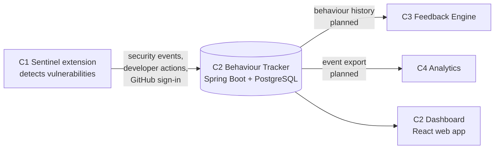

# Component 2 · Developer Behaviour Tracker — Overview

**Owner:** R S D Sulakshana (IT23249752) · **Project:** J26-IT-394, Sentinel ·
**Folder:** `component-2-behaviour-tracker/` · **Branch:** `feature/component-2-backend-foundation`

This document explains **what** Component 2 is, **why** it exists and **where** it stops. It
is for anyone who needs to understand the component before touching it: supervisors,
teammates, and anyone picking up the work.

| Document | Read it for |
|---|---|
| **COMPONENT_OVERVIEW.md** (this file) | Purpose, scope, research role, concepts, current state |
| [TECHNICAL_OVERVIEW.md](TECHNICAL_OVERVIEW.md) | How it is built, the rules to follow, how to make changes safely |
| [TASKS.md](TASKS.md) | What to do next, in order, with acceptance criteria |
| [backend/README.md](backend/README.md) | Setup, endpoints and examples for the backend |
| [../README.md](../README.md) | The whole Sentinel system |

---

## 1. In one paragraph

Component 2 is the **memory** of Sentinel. When the Sentinel VS Code extension (Component 1)
flags a vulnerability, Component 2 stores it as a **security event**. Each later response by
the developer is stored as a **developer interaction**: opening the warning, fixing it,
ignoring it, dismissing it, or reopening it. Every change of status is also written to a
**lifecycle history**. From this history it calculates a **behaviour summary** for each
developer: fix, ignore and reopen rates, response time, repeated vulnerabilities, and an
explainable **behaviour classification**. The other components build on this record: the
feedback engine (C3) and the analytics dashboard (C4).

## 2. The research context

Sentinel asks: **does real-time, behaviour-aware security feedback improve developers'
secure-coding behaviour over time?**

Answering that needs evidence of *behaviour*, not just *detections*. A detector can say
"there were 40 SQL injection warnings this week". It cannot say:

- whether the developer fixed them or ignored them;
- how long they took to respond;
- whether the same mistake came back next week;
- whether high-severity issues were handled differently from low-severity ones;
- whether a developer is improving.

Component 2 records exactly this. Without it, Sentinel is a linter. With it, Sentinel is a
research instrument.

## 3. The problem Component 2 solves

| Problem (from the TAF) | How Component 2 addresses it |
|---|---|
| Security tools generate warnings but record nothing about how developers respond. | Every response is stored as an interaction, tied to the event it responds to. |
| Ignored alerts, repeated mistakes and delayed fixes are rarely tracked. | Ignore and dismiss actions, reopen actions, repeated vulnerability types and the time from detection to response are all recorded. |
| Organisations cannot see the behaviour behind recurring security issues. | Per-developer behaviour summaries and classifications, plus a web dashboard. |
| Feedback is the same for every developer. | C2 provides the behaviour history that C3 needs to personalise feedback. |

## 4. Sub-objective and tasks (from the TAF)

**Sub-objective:** a developer behaviour tracking module that records insecure coding habits
and repeated mistakes for later analysis.

| # | TAF task | Status | Where |
|---|---|---|---|
| T1 | Receive security events from the real-time code detector | ✅ Done | `POST /api/security-events`, connected to C1 |
| T2 | Store alert type, file name, line number, timestamp and user response | ✅ Done | `security_events` + `behaviour_logs` tables |
| T3 | Track whether warnings are ignored, fixed or repeated | 🟡 Partial | Fixed and ignored: done. Repeated: only counted by vulnerability type; the same mistake coming back is not yet linked to its earlier occurrence |
| T4 | Group repeated mistakes by issue type and session | 🟡 Partial | By type: a count only. By session: not yet (session ids are stored on interactions, not on events) |
| T5 | Build behavioural summaries from the collected data | ✅ Done | `GET /api/developer-behaviour/{developerId}` |

T3 and T4 are the main remaining research work. See [TASKS.md](TASKS.md), Phase 2.

**Novelty (from the TAF).** The component does not just store alerts. It studies how
developers respond to them over time, which lets the system move beyond detection and
identify insecure habits and repeated behaviour patterns.

## 5. Where Component 2 sits

| Direction | Partner | What flows | State |
|---|---|---|---|
| In | C1 | GitHub sign-in token, security events, developer actions | Live |
| Out | C2 dashboard | Developers, events, interactions, lifecycle, behaviour summary | Live |
| Out | C3 | Earlier findings, fixes and ignores per developer and type (C3's `BehaviourHistory`) | Planned |
| Out | C4 | Event stream in C4's event schema, to replace C4's simulated data | Planned |

## 6. Scope: what Component 2 does and does not do

**In scope**
- Identify developers through GitHub, verified on the server.
- Store security events, developer interactions and lifecycle history.
- Enforce valid lifecycle transitions.
- Calculate behaviour metrics and an explainable classification.
- Serve all of this over a documented REST API, and show it in the C2 dashboard.
- Provide the data that C3 and C4 need, in a form agreed with them.

**Out of scope** (belongs to another component)
- Detecting vulnerabilities, showing warnings in the editor, deciding what the extension
  sends → **C1**.
- Scoring severity, escalating warnings, writing recommendations → **C3**.
- Forecasting, risk-profile models, correlation analysis, research reports → **C4**.

C2 *serves data for* these. It does not re-implement them.

## 7. Key concepts

| Term | Meaning |
|---|---|
| **Developer** | A person using Sentinel, identified by their GitHub account (`github_id`). `developer_identifier` is their GitHub login. |
| **Security event** | One vulnerability detected by C1: type, severity, file, line, message, time of detection and current status. |
| **Developer interaction** (a.k.a. behaviour log) | One action a developer took on one security event: `OPEN`, `FIX`, `IGNORE`, `DISMISS` or `REOPEN`, with time, session, source and metadata. Both names refer to the same `behaviour_logs` table. |
| **Lifecycle status** | Where an event is now: `DETECTED`, `OPENED`, `IGNORED`, `REOPENED` or `FIXED`. |
| **Lifecycle history** | Every status change of an event: from, to, when and by whom (`SYSTEM` or the developer). |
| **Response time** | Seconds from detection to an action (`time_since_detection_seconds`). |
| **Repeated vulnerability** | Today: a vulnerability type that appears more than once for a developer. Planned: a link from a new detection to an earlier one of the same type in the same file. |
| **Session** | One coding session in the extension. C1 generates a session id and sends it with every action. |
| **Source** | Where an action came from, for example `VSCODE` (from the extension) or `IDE` (in the API examples). |
| **Behaviour classification** | A rule-based label for a developer: `SECURITY_RESPONSIVE`, `SECURITY_AT_RISK`, `RECURRING_SECURITY_BEHAVIOUR`, `SECURITY_NEUTRAL` or `INSUFFICIENT_DATA`. |

## 8. How a vulnerability moves through Component 2

1. The developer signs in with GitHub in the extension. C2 verifies the token with GitHub
   and returns the developer's id.
2. The developer types vulnerable code. C1 flags it and sends a security event. C2 stores it
   as `DETECTED` and writes the first lifecycle entry (by `SYSTEM`).
3. The developer opens the explanation. C1 sends `OPEN`. C2 records the interaction, moves
   the event to `OPENED` and writes a lifecycle entry.
4. The developer fixes it, ignores it or dismisses it. C2 records it and moves the event to
   `FIXED` or `IGNORED`.
5. If the developer comes back to an ignored or fixed event, `REOPEN` moves it to `REOPENED`.
6. At any time, the behaviour summary shows that developer's rates, response time and
   classification.

An action that does not fit the lifecycle (for example `OPEN` on a `FIXED` event) is
rejected, and nothing is stored.

## 9. What works today

| Area | Capability |
|---|---|
| Identity | GitHub sign-in verified against GitHub's API. Existing records are found, linked or created, and a login already linked to a different GitHub account is refused. |
| Recording | Security events, developer interactions, lifecycle history, response times, sessions and sources. |
| Integrity | Lifecycle transitions are enforced. A developer can act only on their own events. Concurrent actions on one event are serialised with a database lock. |
| Analysis | Opened, fixed, ignored, dismissed and reopened counts; fix, ignore, reopen and high-severity fix rates; average response time; repeated vulnerability count; classification. |
| API | 20+ endpoints with Swagger UI, validation and one consistent error format. |
| Dashboard | Developer list, profile, security events, lifecycle timeline and behaviour analysis pages; light and dark themes. |
| Quality | 93 automated tests on an in-memory database. |
| Integration | The Sentinel extension sends real events and actions to C2. |

## 10. Behaviour classification at a glance

The rules are applied in this order. The first that matches wins.

| Label | Plain-language meaning | Rule |
|---|---|---|
| `INSUFFICIENT_DATA` | Not enough history to judge | fewer than 3 events, or fewer than 3 actions |
| `SECURITY_RESPONSIVE` | Fixes most issues, including serious ones, and rarely ignores | fix ≥ 80%, high-severity fix ≥ 80% (or no high-severity events), ignore < 20% |
| `SECURITY_AT_RISK` | Ignores a lot, or leaves serious issues unfixed | ignore ≥ 40%, or high-severity fix < 50% |
| `RECURRING_SECURITY_BEHAVIOUR` | Issues keep coming back | reopen ≥ 30%, or 3 or more repeated vulnerability types |
| `SECURITY_NEUTRAL` | None of the above | — |

These labels describe **measured behaviour in the system**, not the person. The thresholds
are design choices and should be reviewed with the supervisor before any study with real
participants.

## 11. How Component 2 can be demonstrated and evaluated (proposed)

The TAF does not set numeric targets for C2. The following are proposed, to be agreed with
the supervisor:

| Criterion | Evidence |
|---|---|
| **Completeness:** every event and action from C1 is stored | Send a scripted set of findings and actions; compare the counts sent with the counts stored. |
| **Lifecycle correctness:** only valid transitions happen | Automated tests for every allowed and every forbidden transition; history matches the status at every step. |
| **Metric correctness:** rates and counts are right | Hand-calculated expected values for prepared datasets, checked by tests. |
| **Explainability:** each classification can be traced to its rule | The summary returns the metrics behind the label; the dashboard shows the rule. |
| **Repeated mistakes** (after Phase 2) | Prepared sequences where the same mistake returns across sessions are linked and grouped correctly. |
| **Integration:** C3 and C4 consume real C2 data | C3 receives behaviour history from C2; C4's pipeline runs on a C2 export. |
| **Performance** | Response time of the write endpoints under a realistic burst from the extension. |

## 12. Data and ethics

- C2 stores a developer's GitHub id, login and (if public) email, plus their coding-security
  behaviour. This is **data about people**.
- During development, only the team's own data and synthetic test data are used.
- Before any study with real developers: university ethical clearance, informed consent,
  secure storage, anonymised exports where possible, and use for academic research only.
- Credentials are never committed. Configuration comes from environment variables.

## 13. Status and what comes next

As of **17 October 2026**:

- **Backend:** complete for T1, T2 and T5. Partial for T3 and T4.
- **Dashboard:** working.
- **C1 integration:** working.
- **Open issues:**
  - A repeated action that keeps the same status is rejected with `409`. Normal extension
    use can trigger this, and the action is lost.
  - Lifecycle-fix changes are not yet committed.
- **Next:**
  1. Fix the open issues.
  2. Complete T3 and T4 (repeated mistakes and session grouping).
  3. Provide behaviour history to C3 and an event export to C4.

The ordered plan with acceptance criteria is in [TASKS.md](TASKS.md).
