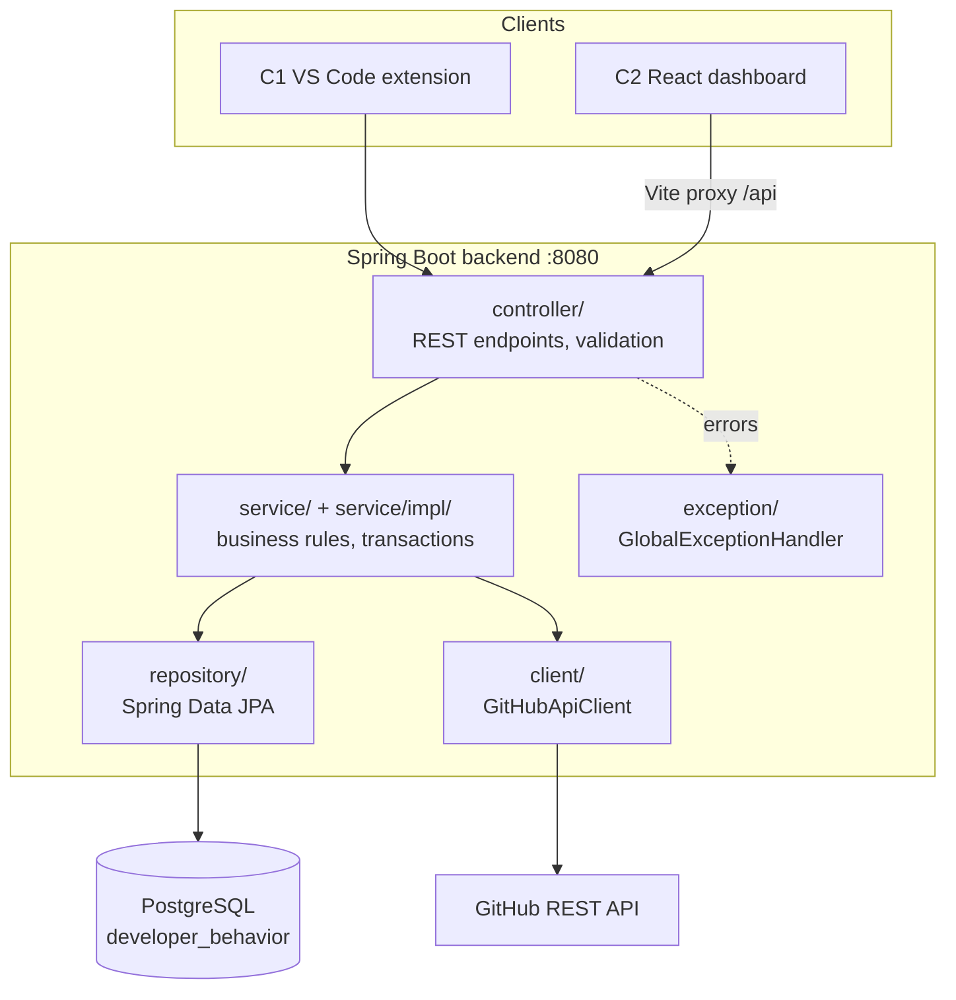
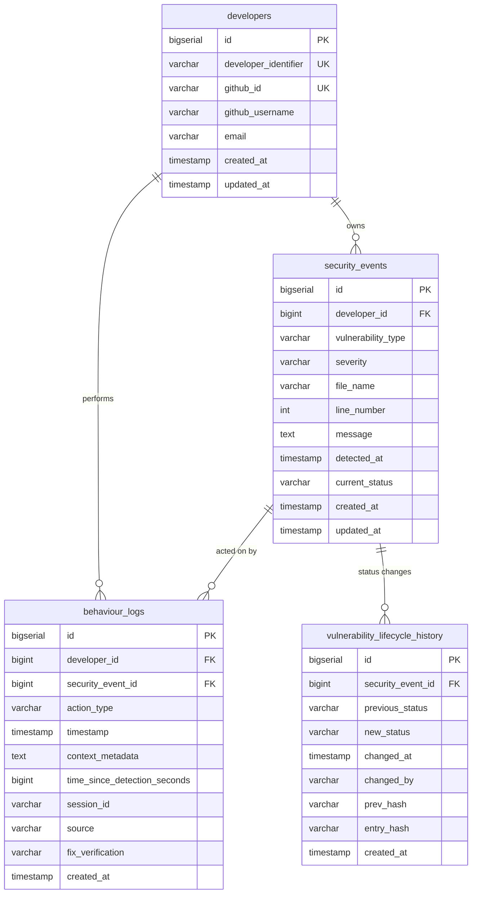

# Component 2 · Developer Behaviour Tracker — Technical Overview

This is the engineering guide for Component 2: how it is built, what must not change, and
how to make each kind of change without breaking the system. Read
[COMPONENT_OVERVIEW.md](COMPONENT_OVERVIEW.md) first for purpose and scope, and pick work
from [TASKS.md](TASKS.md).

Everyone working on C2 follows this document, whoever is doing the work. If the code needs
to differ from it, update this document in the same change.

---

## Contents

0. [Non-negotiable rules](#0-non-negotiable-rules)
1. [Architecture](#1-architecture)
2. [Configuration and running](#2-configuration-and-running)
3. [Data model](#3-data-model)
4. [Enums and the vulnerability lifecycle](#4-enums-and-the-vulnerability-lifecycle)
5. [Write paths](#5-write-paths)
6. [Read paths and transactions](#6-read-paths-and-transactions)
7. [Behaviour analysis](#7-behaviour-analysis)
8. [REST API contract](#8-rest-api-contract)
9. [Integration with Component 1](#9-integration-with-component-1)
10. [Integration with Components 3 and 4](#10-integration-with-components-3-and-4)
11. [The dashboard frontend](#11-the-dashboard-frontend)
12. [Coding conventions](#12-coding-conventions)
13. [Testing](#13-testing)
14. [How to make common changes](#14-how-to-make-common-changes)
15. [Git workflow](#15-git-workflow)
16. [Known pitfalls](#16-known-pitfalls)
17. [Definition of done](#17-definition-of-done)

---

## 0. Non-negotiable rules

Break any of these and the system breaks, sometimes silently.

1. **The C1 → C2 contract is frozen.** The paths, request fields, response fields used by C1
   and success status codes of these three endpoints must not change:
   `POST /api/auth/github`, `POST /api/security-events`, `POST /api/developer-interactions`.
   - Adding an *optional* request field, or an extra response field, is allowed.
   - Renaming, removing or making a field required is not.
   - If a feature needs C1 to change, write a proposal for C1's owner. Do not edit
     `sentinel/`.
2. **One write path for actions.** Every developer action goes through
   `DeveloperInteractionService.createInteraction`. The deprecated `POST /api/behaviour-logs`
   delegates to it. Never write `behaviour_logs` rows anywhere else.
3. **Every status change writes exactly one lifecycle history row**, in the same
   transaction. A status must never change without its history row. Every history row is
   sealed with `LifecycleHashChain.seal` before it is saved, and history rows are never
   updated afterwards (§5.5).
4. **Transitions follow `SecurityEventStatus.allowedTransitions()`.** Change the lifecycle
   only through that method, with tests and documentation (see
   [§14.4](#144-change-the-lifecycle)).
5. **Identity comes from GitHub, not from the client.** At sign-in, use only fields from
   GitHub's `GET /user` response. Never trust identity fields in a request body.
6. **No credentials in git.** `backend/src/main/resources/application.properties` is
   git-ignored. Only `application.properties.example` with placeholders is committed.
7. **`schema.sql`, the entities, the DTOs, the frontend `types.ts` and the docs move
   together.** A field changed in one place is changed in all of them in the same commit.
8. **Tests pass before every commit:** `mvn test` in `backend/`, and `npm run build` in
   `frontend/` if it changed.
9. **Commit messages and PRs never mention Claude or AI, and have no co-author trailer for
   it.** Ask for confirmation before committing or pushing.
10. **Stay inside `component-2-behaviour-tracker/`.** Do not commit other components' files
    with C2 work, for example the extension's `sentinel/src/data/*.json`.

---

## 1. Architecture

### 1.1 Shape

A layered Spring Boot application, with a separate React single-page app for the dashboard.



### 1.2 Package map (`backend/src/main/java/com/sentinel/tracker/`)

| Package | Responsibility | Rules |
|---|---|---|
| `DevBehaviourTrackerApplication` | Entry point | — |
| `controller/` | HTTP mapping, `@Valid` on request bodies, status codes, OpenAPI annotations | No business logic. Call one service method and wrap the result in a `ResponseEntity`. |
| `dto/` | Request and response objects | Requests carry Bean Validation. Responses have a static `from(entity)` factory. Never return an entity from a controller. |
| `entity/` | JPA entities | Lombok `@Data @Builder`. Relationships are `LAZY`. Audit fields use `@CreatedDate` and `@LastModifiedDate`. |
| `enums/` | `Severity`, `BehaviourAction`, `SecurityEventStatus`, `FixVerificationStatus` (and `HistoryIntegrityStatus`) | Stored as `STRING` in the database. The lifecycle lives in `SecurityEventStatus`. |
| `repository/` | Spring Data interfaces | Use derived queries; use `@EntityGraph` when a caller maps lazy relations. |
| `service/` | Interfaces | One interface per use-case area. |
| `service/impl/` | Implementations | Class-level `@Transactional(readOnly = true)`, `@Transactional` on writes. Throw domain exceptions, never return error values. |
| `client/` | Outbound HTTP (GitHub) | Translate failures into domain exceptions. |
| `config/` | JPA auditing, GitHub `RestClient` (5 s connect and read timeouts) | — |
| `exception/` | Domain exceptions and `GlobalExceptionHandler` | Each exception maps to exactly one HTTP status. |
| `analysis/` | `LifecycleHashChain` (history hash chain, §5.5); planned home for repeated-mistake and session analysis (TASKS Phase 2) | Plain classes with no Spring or repository dependencies, so they are unit-testable. |

### 1.3 Services

| Interface | Implementation | Does |
|---|---|---|
| `DeveloperService` | `DeveloperServiceImpl` | Create a developer (`409` if the identifier exists), get one, list all |
| `GitHubAuthService` | `GitHubAuthServiceImpl` | Verify the token, then find, link or create the developer |
| `SecurityEventService` | `SecurityEventServiceImpl` | Create an event and its first lifecycle row; get, list, list by developer |
| `DeveloperInteractionService` | `DeveloperInteractionServiceImpl` | **The single write path for actions**; reads |
| `FixVerificationService` | `ClaimOnlyFixVerificationService` | Whether a `FIX` claim is verified (§4.5). Returns `CLAIMED` until a verification source exists |
| `BehaviourLogService` | `BehaviourLogServiceImpl` | Legacy API: the create call delegates to interactions; reads |
| `VulnerabilityLifecycleHistoryService` | `VulnerabilityLifecycleHistoryServiceImpl` | History of an event, oldest first; verify its hash chain (§5.5) |
| `BehaviourAnalysisService` | `BehaviourAnalysisServiceImpl` | Behaviour summary and classification |

### 1.4 Tech stack

- **Backend:** Java 17 · Spring Boot 3.3.5 (Web, Data JPA, Validation) · Hibernate ·
  PostgreSQL 14+ via HikariCP · springdoc-openapi 2.6.0 · Lombok · Maven.
- **Tests:** JUnit 5, Mockito, MockMvc, `@DataJpaTest`, H2 2.1.
- **Dashboard:** React 19 · React Router 7 · Axios · TypeScript 5.9 · Vite 6.

---

## 2. Configuration and running

### 2.1 Configuration

The template is `backend/src/main/resources/application.properties.example`. Copy it to
`application.properties` (git-ignored) and set:

| Key / env var | Default | Notes |
|---|---|---|
| `server.port` | `8080` | C1's `sentinel.backendUrl` default points here; do not change it casually |
| `DB_HOST` / `DB_PORT` / `DB_NAME` | `localhost` / `5432` / `developer_behavior` | Optional |
| `DB_USERNAME` / `DB_PASSWORD` | — | Required; environment only |
| `spring.jpa.hibernate.ddl-auto` | `update` | Hibernate adds columns but never drops or renames them; see §3.4 |
| `spring.jpa.open-in-view` | `false` | Lazy relations cannot load after the service returns; see §6 |
| `github.api.base-url` | `https://api.github.com` | Override only for tests or a mock |
| `springdoc.api-docs.path` / `swagger-ui.path` | `/api-docs` / `/swagger-ui.html` | — |

The test profile (`src/test/resources/application-test.properties`) uses H2 in memory with
`create-drop`, and turns Swagger off.

### 2.2 Commands

```bash
# backend
cd component-2-behaviour-tracker/backend
export DB_USERNAME=... DB_PASSWORD=...
mvn spring-boot:run              # http://localhost:8080, Swagger UI at /swagger-ui.html
mvn test                         # H2, no PostgreSQL needed

# dashboard
cd component-2-behaviour-tracker/frontend
npm install
npm run dev                      # http://localhost:5173, proxies /api to :8080
npm run build                    # type-check (tsc -b) + production build
```

---

## 3. Data model

### 3.1 Entity-relationship diagram



### 3.2 Tables in detail

**`developers`**

| Column | Type | Constraints | Set by |
|---|---|---|---|
| `id` | BIGSERIAL | PK | DB |
| `developer_identifier` | VARCHAR(255) | NOT NULL, UNIQUE | GitHub login at creation; never overwritten |
| `github_id` | VARCHAR(100) | UNIQUE, nullable (legacy rows) | Verified GitHub id |
| `github_username` | VARCHAR(255) | — | Refreshed at each sign-in |
| `email` | VARCHAR(255) | — | Refreshed at sign-in only if GitHub returns one |
| `created_at`, `updated_at` | TIMESTAMP | NOT NULL | JPA auditing |

**`security_events`**

| Column | Type | Constraints | Notes |
|---|---|---|---|
| `developer_id` | BIGINT | NOT NULL, FK → developers ON DELETE CASCADE | Owner of the event |
| `vulnerability_type` | VARCHAR(255) | NOT NULL | Free text so C1 can add types; C1 sends values like `SQL_INJECTION` |
| `severity` | VARCHAR(50) | NOT NULL | `Severity` enum |
| `file_name` | VARCHAR(500) | NOT NULL | Full path from C1 |
| `line_number` | INT | NOT NULL, ≥ 0 | 1-indexed from C1; 0 is accepted |
| `message` | TEXT | NOT NULL | — |
| `detected_at` | TIMESTAMP | NOT NULL | From the request (`detectedAt` or alias `timestamp`), else server time |
| `current_status` | VARCHAR(50) | NOT NULL, default `DETECTED` | Changed only by the interaction service |

**`behaviour_logs`** (developer interactions)

| Column | Type | Constraints | Notes |
|---|---|---|---|
| `developer_id` | BIGINT | NOT NULL, FK ON DELETE CASCADE | Actor |
| `security_event_id` | BIGINT | FK ON DELETE SET NULL; nullable | Required by the API; nullable only so old logs survive an event's deletion |
| `action_type` | VARCHAR(50) | NOT NULL | `BehaviourAction` |
| `timestamp` | TIMESTAMP | NOT NULL | `actionTimestamp` from the request, else server time |
| `context_metadata` | TEXT | — | Raw JSON string from the client (C1 sends `extensionAction` and `confidence`) |
| `time_since_detection_seconds` | BIGINT | — | `timestamp − event.detected_at` |
| `session_id` | VARCHAR(255) | — | C1's session id |
| `source` | VARCHAR(255) | — | `VSCODE` from C1 |
| `fix_verification` | VARCHAR(50) | — | `FixVerificationStatus` on `FIX` rows (§4.5); `NULL` on other actions. Older FIX rows are set to `CLAIMED` by `schema.sql` |

**`vulnerability_lifecycle_history`**

| Column | Notes |
|---|---|
| `previous_status` | `NULL` only on the first row (`→ DETECTED`) |
| `new_status` | NOT NULL |
| `changed_at` | Event's `detected_at` for the first row; the action's timestamp after that. Truncated to microseconds (§5.5) |
| `changed_by` | `SYSTEM` for the first row; the developer's `developer_identifier` after that |
| `prev_hash` | VARCHAR(64), nullable. The previous row's `entry_hash` (genesis value for the first). `NULL` on rows written before P2-9 |
| `entry_hash` | VARCHAR(64), nullable. SHA-256 over `prev_hash` and the row's fields (§5.5). `NULL` on rows written before P2-9 |

### 3.3 Indexes

| Table | Indexed columns |
|---|---|
| `developers` | `developer_identifier`, `github_id` |
| `security_events` | `developer_id`, `detected_at`, `vulnerability_type`, `severity`, `current_status` |
| `behaviour_logs` | `developer_id`, `security_event_id`, `timestamp`, `action_type` |
| `vulnerability_lifecycle_history` | `security_event_id`, `changed_at` |

A new query that filters or sorts on a column not listed here needs an index in both the
entity's `@Table(indexes = …)` and `schema.sql`.

### 3.4 Schema changes

`ddl-auto=update` adds new columns and tables. It does **not** rename, drop, retype or
backfill anything. So:

- **Adding a nullable column:** update the entity *and* add
  `ALTER TABLE … ADD COLUMN IF NOT EXISTS …` to `schema.sql`, following the pattern already
  used for the GitHub columns.
- **Adding a NOT NULL column:** add it as nullable, backfill it, then tighten it, with each
  step written in `schema.sql`. Never add a NOT NULL column without a default to a table
  that has rows.
- **Renaming or dropping:** write the SQL in `schema.sql`, test it on a copy of a real
  database, and record it in the commit message.
- A move to Flyway is a backlog item in TASKS.md. Until then, `schema.sql` is the migration
  record.

---

## 4. Enums and the vulnerability lifecycle

### 4.1 Enums

| Enum | Values | Notes |
|---|---|---|
| `Severity` | `LOW`, `MEDIUM`, `HIGH`, `CRITICAL` | C1 also has `INFO` and sends it as `LOW`. Do not add `INFO` without agreement, because the C1 mapping depends on it. |
| `BehaviourAction` | `OPEN`, `IGNORE`, `FIX`, `REOPEN`, `DISMISS` | An unknown value gets `400` (tested). |
| `SecurityEventStatus` | `DETECTED`, `OPENED`, `IGNORED`, `REOPENED`, `FIXED` | — |
| `FixVerificationStatus` | `CLAIMED`, `VERIFIED`, `STILL_VULNERABLE` | Set on `FIX` interactions only (§4.5). |

### 4.2 Action → status

| Action | Target status |
|---|---|
| `OPEN` | `OPENED` |
| `FIX` | `FIXED` |
| `IGNORE` | `IGNORED` |
| `DISMISS` | `IGNORED` (kept as `DISMISS` in the log) |
| `REOPEN` | `REOPENED` |

### 4.3 Allowed transitions (`SecurityEventStatus.allowedTransitions()`)

| From | Allowed next |
|---|---|
| `DETECTED` | `OPENED`, `FIXED`, `IGNORED` |
| `OPENED` | `FIXED`, `IGNORED` |
| `IGNORED` | `OPENED`, `FIXED`, `REOPENED` |
| `REOPENED` | `OPENED`, `FIXED`, `IGNORED` |
| `FIXED` | `REOPENED` |

`IGNORED → OPENED` must stay valid. In C1, ignored findings reappear and can be opened again.

### 4.4 Same-status actions

- An action whose target equals the current status (a second `OPEN`, or `DISMISS` after
  `IGNORE`) is **not a transition**. The interaction is stored (with its response time) and
  the API returns `201`, but the status is left unchanged and **no** history row is written
  (TASKS **P1-1**, done 2026-10-20).
- **Why:** C1 sends `OPEN` both when an explanation is viewed and when a secure example is
  viewed, and drops a request silently after 3 failed retries. Rejecting the repeat lost real
  behaviour.
- Real transitions that are not allowed (for example `OPEN` on `FIXED`) still get `409`, and
  nothing is stored.
- Analysis is unaffected for rates and counts, which use distinct events (§7.1).
  `averageResponseTimeSeconds` and the `INSUFFICIENT_DATA` action count do include the
  repeated logs, as they include every log.

### 4.5 Claimed versus verified fixes

- A `FIX` is a **claim**. C1 sends it for `FIX_APPLIED`, which only shows the secure example
  (`sentinel/src/extension.ts`, `handleFixAction`). C2 has no evidence about the code.
- The lifecycle is unchanged: `FIX` still moves the event to `FIXED`, because `FIXED` records
  what the developer reported and C1 drops rejected requests (§9.3).
- Each `FIX` log stores `fix_verification` from `FixVerificationService.verifyFix(event,
  claimedAt)`: `CLAIMED` (no evidence), `VERIFIED` or `STILL_VULNERABLE`. A `null` answer is
  stored as `CLAIMED`. Other actions store `NULL` and never call the service.
- `ClaimOnlyFixVerificationService` is the only implementation and returns `CLAIMED`. Tests
  use a mock with controlled results. A real source needs C1 to report whether the finding is
  still present after a fix, which is a C1 change (📝 proposal, see TASKS "Notify other
  components"). The service runs inside the write transaction under the row lock, so it must
  not make slow calls.
- `STILL_VULNERABLE` does not reopen the event or reject the claim. It is evidence for
  analysis, not a lifecycle rule.
- Analysis: `fixedCount`/`fixRate` count claimed fixes and drive the classification
  (unchanged; changing that needs the supervisor, §7.3). `verifiedFixCount`/`verifiedFixRate`
  count only `VERIFIED` fixes (§7.1).

---

## 5. Write paths

### 5.1 Create a security event — `SecurityEventServiceImpl.createSecurityEvent`

One transaction:

1. Load the developer (`404` if missing).
2. `detectedAt` = request value, or `now()`, truncated to microseconds.
3. Save the event with status `DETECTED`.
4. Save the history row `(null → DETECTED, changedAt = detectedAt, changedBy = "SYSTEM")`,
   sealed with the genesis `prevHash` (§5.5).
5. Return `201` with a `SecurityEventResponse`.

### 5.2 Record an action — `DeveloperInteractionServiceImpl.createInteraction`

One transaction:

1. Load the developer (`404`).
2. Load the event with `findByIdForUpdate`, which takes a `PESSIMISTIC_WRITE` row lock
   (`404`). The lock serialises concurrent actions on one event, so two clicks cannot both
   pass the transition check.
3. **Ownership:** if `event.developer.id ≠ developer.id`, return `403`
   (`AccessDeniedException`).
4. Target status = `resolveTargetStatus(action)`.
5. **Transition check:** if the target differs from the current status and the transition
   is not allowed, return `409` (`InvalidStatusTransitionException`; the message lists the
   allowed statuses). A same-status action skips this check (§4.4).
6. `actionTimestamp` = request value, or `now()`.
   `timeSinceDetectionSeconds = SECONDS.between(event.detectedAt, actionTimestamp)`.
7. For `FIX` only: `fixVerification = FixVerificationService.verifyFix(event, actionTimestamp)`,
   or `CLAIMED` if it returns `null` (§4.5).
8. Save the `BehaviourLog`.
9. Only if the status changes: set the event's status and save it.
10. Only if the status changes: save the history row `(current → target,
   changedAt = actionTimestamp, changedBy = developerIdentifier)`, sealed with
   `prevHash` = the `entry_hash` of the event's latest row (`findFirstBySecurityEventIdOrderByIdDesc`).
11. Return `201` with a `DeveloperInteractionResponse` (including `fixVerification`).

Rules for changing this method:
- Keep the lock. It also keeps the hash chain linear: two concurrent actions cannot both
  read the same latest row.
- Keep the ownership check before the transition check.
- Never write history without a status change, or a status change without history.

### 5.3 Legacy action write — `BehaviourLogServiceImpl.createBehaviourLog`

- Logs a deprecation warning.
- Maps `actionType`, `timestamp` and `contextMetadata` onto an interaction request and calls
  §5.2.
- The controller adds `Deprecation: true` and a `Link` header.
- Do not add features here. Point clients to `/api/developer-interactions`.

### 5.4 GitHub sign-in — `GitHubAuthServiceImpl.authenticateWithGitHub`

- **Not** `@Transactional`, so no database connection is held during the GitHub call (5 s
  timeouts).
- Steps:
  1. Call `GitHubApiClient.fetchAuthenticatedUser(token)`, which sends `GET /user` with
     `Authorization: Bearer <token>` and `X-GitHub-Api-Version: 2022-11-28`.
     - A GitHub `401` becomes `InvalidGitHubTokenException` (`401`).
     - A network failure or incomplete profile becomes `GitHubApiException` (`502`).
  2. Find the developer by `github_id`. If found, refresh the login and email, and return
     it.
  3. Otherwise find by `developer_identifier == login`:
     - if that record has no `github_id`, link it and return it;
     - if it is linked to a different GitHub id, return `409`.
  4. Otherwise create a new developer with `developer_identifier = login`.
- The token is never stored or logged.

### 5.5 Lifecycle hash chain — `analysis/LifecycleHashChain` (tamper evidence)

The history rows of one event form a hash chain, so later edits can be detected.

- **Order.** Rows are chained in id (insertion) order, not `changed_at` order, because
  `changed_at` comes from the client's `actionTimestamp` and need not increase.
- **Hash.** `entry_hash = SHA-256(prev_hash|security_event_id|previous_status|new_status|changed_at|changed_by)`,
  hex-encoded, with `null` written as an empty string and `changed_at` formatted as
  `uuuu-MM-dd'T'HH:mm:ss.SSSSSS`. The first row of each event uses the genesis value (64
  zeros) as `prev_hash`.
- **Precision.** `changed_at` is truncated to microseconds *before it is saved*
  (`LifecycleHashChain.normalise`, applied by `seal`). PostgreSQL stores microseconds and
  rounds anything finer, so an untruncated value would read back differently and break its
  own hash.
- **Writing.** Both writers call `LifecycleHashChain.seal(entry, prevHash)` just before
  saving (§5.1 step 4, §5.2 step 10). Same-status actions write no row, so they do not touch
  the chain.
- **Verifying.** `GET /api/lifecycle-history/security-event/{id}/verify` walks the rows in
  id order:
  - leading rows with both hashes `NULL` were written before the chain existed and are
    counted in `unchainedEntryCount`;
  - from the first chained row on, `prev_hash` must equal the previous row's `entry_hash`
    (genesis for the first chained row), and `entry_hash` must match the row's fields;
  - the first failure gives `BROKEN` with `brokenAtEntry` (1-based position),
    `brokenAtHistoryId` and `reason`. An event with no rows at all is `BROKEN` at entry 1,
    because every event gets a `DETECTED` row when it is created;
  - otherwise the result is `VALID`, or `UNCHAINED` if any legacy rows exist.
- **What it detects.** An edited field (`BROKEN` at that row); a deleted, inserted or
  reordered row, or a re-hashed edited row (`BROKEN` at the next row); a row whose hashes
  were removed after chained rows.
- **Limits.** The history is tamper-*evident*, not tamper-proof. Someone with write access
  who knows the algorithm can rebuild the whole chain. Deleting the newest rows is not
  detected without an outside anchor (a 📝 follow-up in TASKS P2-9). Legacy rows are not
  backfilled, since that would vouch for history that was never protected.

---

## 6. Read paths and transactions

- `spring.jpa.open-in-view=false`. Lazy relations (`BehaviourLog.developer`,
  `BehaviourLog.securityEvent`, `SecurityEvent.developer`) are only loadable **inside a
  transaction**.
- Every service implementation is annotated `@Transactional(readOnly = true)` at class
  level, and writes override it with `@Transactional`.
- Response DTOs read relation ids (`log.getSecurityEvent().getId()`). Read methods must
  therefore:
  - run inside a transaction, **and**
  - load the relations they map, using `@EntityGraph` on the repository method.

  `BehaviourLogRepository` does this for `findById`, `findByDeveloperId`,
  `findBySecurityEventId` and `findByDeveloperIdAndActionType`, tested by
  `BehaviourLogRepositoryTest` (TASKS **P0-1**).
- `findAll()` is not overridden with an entity graph, so it runs one query per log (N+1)
  within its transaction. Watch this once data grows (TASKS **P5-3**).
- A new repository method whose results are mapped through a lazy relation needs
  `@EntityGraph(attributePaths = …)`.

---

## 7. Behaviour analysis

Source: `BehaviourAnalysisServiceImpl.getDeveloperBehaviourSummary`.

### 7.1 Algorithm

1. `404` if the developer does not exist.
2. `events` = all the developer's security events. `total = events.size()`.
3. `logs` = all the developer's behaviour logs. `ownEventIds` = ids of `events`.
4. For each action set, `eventIdsWithAction` returns the **distinct** ids of the
   developer's own events that received the action at least once. It skips logs with no
   event and logs on other developers' events.
   - opened = `{OPEN}`
   - fixed = `{FIX}`
   - ignored = `{IGNORE}`
   - dismissed = `{DISMISS}`
   - reopened = `{REOPEN}`
   - ignoredOrDismissed = `{IGNORE, DISMISS}`
5. Rates = `round(count / total × 100, 1)`, capped at 100; `0.0` when `total = 0`.
   - `fixRate` uses fixed.
   - `ignoreRate` uses ignoredOrDismissed (an event both ignored and dismissed counts once).
   - `reopenRate` uses reopened.
   - `verifiedFixRate` uses verifiedFixed. `fixRate` and `fixedCount` count **claimed** fixes.
   - verifiedFixed = `{FIX}` logs whose `fix_verification` is `VERIFIED` (§4.5)
6. `highSeverityFixRate` = fixed HIGH or CRITICAL events / all HIGH or CRITICAL events.
   It is **`null`** when there are none, meaning "not applicable", not 0.
7. `averageResponseTimeSeconds` = the mean of `time_since_detection_seconds` over **all**
   logs that have it (every action, not only the first), rounded to 1 decimal; `0.0` if
   there are none.
8. `repeatedVulnerabilityCount` = the number of **vulnerability types** with more than one
   event.
9. Classification: see §7.2.

Note the different denominators. Rates are per event, but `INSUFFICIENT_DATA` counts *all*
logs (`allLogs.size()`).

### 7.2 Classification (first match wins)

```
if total < 3 or logCount < 3                              → INSUFFICIENT_DATA
hsHandled   = hsFixRate == null or hsFixRate ≥ 80
hsNeglected = hsFixRate != null and hsFixRate < 50
if fix ≥ 80 and hsHandled and ignore < 20                 → SECURITY_RESPONSIVE
if ignore ≥ 40 or hsNeglected                             → SECURITY_AT_RISK
if reopen ≥ 30 or repeatedVulnerabilityCount ≥ 3          → RECURRING_SECURITY_BEHAVIOUR
else                                                      → SECURITY_NEUTRAL
```

### 7.3 Rules for changing the analysis

- A change to a threshold, a rule or a definition needs **all** of these:
  1. a test with hand-calculated expected values;
  2. matching edits to `CLASSIFICATION_RULES` in `frontend/src/components/Badges.tsx` (the
     dashboard explains the rules to users);
  3. updates to `backend/README.md`, this file and `COMPONENT_OVERVIEW.md` §10;
  4. a note to the C3 and C4 owners if they consume the field.
- Keep the "distinct events" semantics. Rates must never exceed 100%.
- Keep `null` meaning "not applicable". The dashboard renders `null` as "—".
- New metrics are **added** fields of `DeveloperBehaviourSummaryResponse`. Never rename or
  remove existing ones.

---

## 8. REST API contract

### 8.1 Endpoints

🔒 = used by C1; frozen (§0 rule 1).

| Method | Path | Request | Success | Errors |
|---|---|---|---|---|
| GET | `/` | — | `200` text `Sentinel Behaviour Tracker Backend is Running` | — |
| POST 🔒 | `/api/auth/github` | `GitHubAuthRequest` | `200` `DeveloperResponse` | 400, 401, 409, 502 |
| POST | `/api/developers` | `CreateDeveloperRequest` | `201` `DeveloperResponse` | 400, 409 |
| GET | `/api/developers` · `/api/developers/{id}` | — | `200` | 404 |
| POST 🔒 | `/api/security-events` | `CreateSecurityEventRequest` | `201` `SecurityEventResponse` | 400, 404 |
| GET | `/api/security-events` · `/{id}` · `/developer/{developerId}` | — | `200` | 404 |
| POST 🔒 | `/api/developer-interactions` | `CreateDeveloperInteractionRequest` | `201` `DeveloperInteractionResponse` | 400, 403, 404, 409 |
| GET | `/api/developer-interactions` · `/{id}` · `/developer/{developerId}` · `/security-event/{securityEventId}` | — | `200` | 404 |
| POST | `/api/behaviour-logs` (deprecated) | `CreateBehaviourLogRequest` | `201` + `Deprecation`/`Link` headers | as interactions |
| GET | `/api/behaviour-logs` · `/{id}` · `/developer/{developerId}` | — | `200` | 404 |
| GET | `/api/lifecycle-history/security-event/{id}`; also served at `/api/lifecycle/security-event/{id}`, `/api/lifecycle-history/{id}` and `/api/lifecycle/{id}` | — | `200` list, oldest first (each item includes `entryHash`) | 404 |
| GET | `/api/lifecycle-history/security-event/{id}/verify`; also served at the same three alias prefixes with `/verify` | — | `200` `HistoryVerificationResponse` (`status` `VALID`/`BROKEN`/`UNCHAINED`, §5.5) | 404 |
| GET | `/api/developer-behaviour/{developerId}` | — | `200` `DeveloperBehaviourSummaryResponse` | 404 |

The dashboard uses the `/api/lifecycle/...` alias. Keep all four lifecycle paths.

### 8.2 Request validation

| DTO | Field | Rule |
|---|---|---|
| `GitHubAuthRequest` | `githubAccessToken` | not blank, ≤ 500 |
| `CreateDeveloperRequest` | `developerIdentifier` | not blank, ≤ 255 |
| `CreateSecurityEventRequest` | `developerId` | not null |
| | `vulnerabilityType` | not blank, ≤ 255 |
| | `severity` | not null, valid enum |
| | `fileName` | not blank, ≤ 500 |
| | `lineNumber` | not null, ≥ 0, numeric |
| | `message` | not blank |
| | `detectedAt` (alias `timestamp`) | optional |
| `CreateDeveloperInteractionRequest` | `securityEventId`, `developerId`, `action` | not null; `action` must be a valid enum |
| | `sessionId`, `source` | optional, ≤ 255 each |
| | `actionTimestamp`, `metadata` | optional |

Validation messages follow the form `"<field> must …"`. When several fields fail, all of
them are reported.

### 8.3 Error format (`ApiErrorResponse`)

```json
{ "timestamp": "2026-10-17T10:15:00", "status": 409, "error": "Conflict",
  "message": "Security event 7 cannot move from FIXED to OPENED (action OPEN); allowed next statuses: [REOPENED]",
  "path": "/api/developer-interactions" }
```

| Exception | Status |
|---|---|
| `MethodArgumentNotValidException`, `HttpMessageNotReadableException` | 400 |
| `InvalidGitHubTokenException` | 401 |
| `AccessDeniedException` (C2's own class, not Spring Security's) | 403 |
| `ResourceNotFoundException` | 404 |
| `DuplicateResourceException`, `InvalidStatusTransitionException` | 409 |
| `GitHubApiException` | 502 |
| Anything else | 500 (generic message; details only in the log) |

A new failure mode gets a new exception class and one handler method. Never return error
bodies from controllers directly.

---

## 9. Integration with Component 1

C1 is `sentinel/`. Its relevant files are `src/auth/authManager.ts` (sign-in) and
`src/events/securityEventClient.ts` (events and actions). Read them; do not edit them.

### 9.1 How C1 calls C2

- **Sign-in:** `POST /api/auth/github` with body `{"githubAccessToken"}` only. C1 keeps the
  returned `id` (in `globalState`, key `sentinel.backendDeveloperId`) and never stores the
  token.
- **Detections:** one `POST /api/security-events` per finding, keyed in C1 by
  `file + line + type` to avoid duplicates. C1 stores the returned event `id` to use in
  later actions.
- **Actions:** `POST /api/developer-interactions` with:
  - `securityEventId`, `developerId`, `action`;
  - `sessionId` (one per extension activation);
  - `source: "VSCODE"`;
  - `metadata: "{\"extensionAction\":\"…\",\"confidence\":0.92}"`.
- **Delivery:**
  - queued and sent every 1 s, in order;
  - 5 s timeout per request;
  - a non-2xx response is retried 3 times, then **dropped silently**;
  - events are held until a developer id exists.
- **Severity:** C1's `INFO` is sent as `LOW`.

### 9.2 Action mapping in C1 (`ACTION_MAP`)

| C1 `DeveloperAction` | Sent as |
|---|---|
| `EXPLANATION_VIEWED`, `SECURE_EXAMPLE_VIEWED` | `OPEN` |
| `FIX_APPLIED`, `FIXED` | `FIX` |
| `IGNORED`, `MARKED_FALSE_POSITIVE` | `IGNORE` |
| `DISMISSED` | `DISMISS` |
| `REOPEN` | `REOPEN` |
| `DETECTED`, `WARNING_SHOWN` | not sent as actions |

### 9.3 Consequences for C2

- Since non-2xx responses are dropped silently, **every action C1 can legitimately send in
  normal use must succeed**. That is why same-status actions must be accepted (§4.4).
- The *original* C1 action (for example `MARKED_FALSE_POSITIVE` versus `IGNORED`) and the
  confidence survive only inside `context_metadata`. Analysis that needs them must parse
  that JSON. It must tolerate the field being missing or malformed, because other clients
  can send anything.
- `developerId` in the body is **asserted by the client**. The ownership check compares
  client-supplied ids only. Binding requests to a verified identity (for example a token
  issued by C2) would need C1 to change, so it is a **proposal only** (TASKS **P5-1**).

---

## 10. Integration with Components 3 and 4

Neither integration exists yet. Agree the shapes with the owner first (D R Pathirage for C3,
D S Gayanatha for C4) and record the agreement in TASKS.md.

### 10.1 What C3 needs: its `BehaviourHistory` record

| C3 field | Source in C2 |
|---|---|
| `developerId` | `developers.id` (C3 uses a string) |
| `previousFindings` | count of the developer's security events (before the current one) |
| `previousFixes` | distinct events with a `FIX` |
| `previousIgnores` | distinct events with `IGNORE` or `DISMISS` |
| `findingsByType` | events grouped by `vulnerability_type` |

C3's escalation thresholds (2 or more ignores → up one level; 3 or more fixes → down one
level) make these counts directly decision-relevant. Document whether "previous" means
"before this event" or "all time" as part of the agreement.

### 10.2 What C4 needs: its event record

| C4 field | Source in C2 | Gap |
|---|---|---|
| `eventId` | `security_events.id` | — |
| `developerId` | `developers.id` or a pseudonym | Decide on anonymisation |
| `sessionId` | `session_id` of the event's first action | Events have no session |
| `vulnerabilityType`, `severity`, `fileName`, `lineNumber`, `detectedAt` | `security_events` | C4 has no `CRITICAL`; agree a mapping |
| `confidence` | `context_metadata.confidence` | Not stored as a column |
| `action` (`FIXED`, `IGNORED`, `DISMISSED`, `FALSE_POSITIVE`) | Final or first response | `FALSE_POSITIVE` comes only from `metadata.extensionAction == MARKED_FALSE_POSITIVE`; agree first versus final |
| `fixedAt` | Timestamp of the `FIX` log | — |
| `responseTime` | `time_since_detection_seconds` of the chosen action | — |

C4's optional `sessions.jsonl` (`sessionId`, `developerId`, `startedAt`) can be derived from
the earliest log per `session_id`.

---

## 11. The dashboard frontend

### 11.1 Structure (`frontend/src/`)

| Path | Role |
|---|---|
| `main.tsx`, `App.tsx` | Entry point; routes (React Router) |
| `api/client.ts` | Axios instance with base URL `/api` and a 10 s timeout. `normalizeError` turns failures into `ApiError` (`unreachable` for timeouts and 5xx). The `api` object holds every call. |
| `hooks/useApi.ts` | Data-fetching hook with abort support |
| `hooks/useTheme.ts` | Light and dark theme |
| `types.ts` | TypeScript mirrors of the backend DTOs |
| `components/Badges.tsx` | Status, severity, action and classification badges, plus **`CLASSIFICATION_RULES`** (the rules from §7.2, in words) |
| `components/Cards.tsx` | `Card`, `StatTile`, `Meter`, page header, loading, error and empty states, formatters |
| `components/Layout.tsx`, `Icon.tsx` | Shell and icons |
| `pages/` | `Home`, `DeveloperProfile`, `SecurityEvents`, `LifecycleTimeline`, `BehaviourAnalysis`, `QualityTests` (with `QualityTests.css`) |
| `../dev/` (outside `src/`) | Node scripts for the test report (TASKS P1-5): `surefireReport.mjs` reads Surefire's XML, `qualityPlugin.mjs` is the dev-server plugin behind the Quality page, `testReport.mjs` is `npm run test:report`, `quality.test.mjs` is `npm test` |

### 11.2 Routes

| Route | Page |
|---|---|
| `/` | Home |
| `/developers/:developerId` | Developer profile |
| `/developers/:developerId/security-events` | Security events |
| `/developers/:developerId/lifecycle` | Lifecycle timeline |
| `/developers/:developerId/behaviour` | Behaviour analysis |
| `/quality` | Quality & Regression Tests (§13.4) |
| `*` | Not found |

### 11.3 Frontend rules

- **`types.ts` mirrors the DTOs.** A backend response field that changes is changed here in
  the same commit.
- **`CLASSIFICATION_RULES` mirrors §7.2.** The thresholds shown to users must match the
  backend exactly.
- All HTTP calls go through `api` in `client.ts`, never through a direct `fetch` or `axios`
  call in a page.
- The dashboard is **read-only**. It must not write security events or interactions (that
  would bypass C1 and pollute research data). The Quality page's **Run test suite** button
  is not an exception: it runs `mvn test` on the H2 test database through the dev server and
  never touches the application's data (§13.4).
- Every page handles loading, error (including "backend unreachable") and empty states with
  the shared components.
- `dist/` and `node_modules/` are git-ignored. Do not commit build output.

---

## 12. Coding conventions

| Topic | Convention |
|---|---|
| Injection | Constructor injection via `@RequiredArgsConstructor` with `private final` fields |
| Logging | `@Slf4j`. `info` for creates, `warn` for deprecated use and conflicts. Never log tokens, emails or full metadata. |
| Transactions | Class-level `@Transactional(readOnly = true)`; `@Transactional` on each write method |
| DTO mapping | `public static XResponse from(Entity)` on the response class |
| Entities | Lombok `@Data @Builder @NoArgsConstructor @AllArgsConstructor`; `@Builder.Default` for default values; `FetchType.LAZY` on `@ManyToOne` |
| Enums in the DB | `@Enumerated(EnumType.STRING)`, never `ORDINAL` |
| Exceptions | Domain exception classes in `exception/`; the handler maps them; services throw |
| Javadoc | A short class-level comment describing behaviour and rules, as in the existing services; section dividers `// ── Name ───` |
| API docs | `@Tag` on controllers, `@Operation(summary = …)` on endpoints |
| Naming | REST paths are plural kebab-case (`/api/security-events`); Java classes are `XController`, `XService`, `XServiceImpl`, `XRepository`, `CreateXRequest`, `XResponse` |

---

## 13. Testing

### 13.1 What exists (402 test methods in 32 classes)

| Class | Type | Covers |
|---|---|---|
| `DeveloperRepositoryTest` | `@DataJpaTest` | Save, find, exists |
| `BehaviourLogRepositoryTest` | `@DataJpaTest` | The four `@EntityGraph` reads load developer and event; results map to DTOs after detaching |
| `SecurityEventRepositoryPhase02Test` | `@DataJpaTest` | Persistence, default status, filters, counts |
| `DeveloperServiceTest` | Mockito | Create, duplicate, get, list |
| `SecurityEventServiceTest` | Mockito | Create with initial history, the initial row starts the hash chain (genesis `prevHash`), not found |
| `SecurityEventServicePhase02Test` | Mockito (nested) | Timestamps, statuses, fields, severities, line 0, list and get |
| `GitHubAuthServiceTest` | Mockito | New, existing, legacy link, conflict, invalid token, GitHub down |
| `BehaviourLogServiceTest` | Mockito | Delegation to interactions, legacy response |
| `BehaviourAnalysisServiceTest` | Mockito | Every classification, distinct counting, ≤ 100% rates, not-applicable high-severity rate, repeated `OPEN`s change no rate |
| `DeveloperInteractionServiceTest` | Mockito | Same-status `OPEN` and `DISMISS` (logged, no status change, no history), valid transition writes one correct history row, the new row is chained to the latest row's `entryHash`, `OPEN` on `FIXED` stores nothing |
| `SecurityEventControllerTest` | MockMvc | All validation cases, 201, 404 |
| `DeveloperInteractionControllerTest` | MockMvc | 201, 400 cases, 403, 409, length limits, unknown action |
| `DeveloperInteractionFlowIntegrationTest` | `@SpringBootTest` + H2 | Real C1-style requests: second `OPEN` and `DISMISS` after `IGNORE` → 201 with no history row; `OPEN` on `FIXED` → 409, nothing stored |
| `LifecycleHistoryVerificationIntegrationTest` | `@SpringBootTest` + H2 | Hash chain through the real write path: untouched → `VALID`; edited status, edited timestamp, deleted, reordered, re-hashed and hash-stripped rows → `BROKEN` at the expected entry; legacy rows → `UNCHAINED`; newest-row deletion not detected (documented limit); 404; alias path; chain cost on 205 rows |
| `LifecycleHashChainTest` | Unit | Deterministic hash, every field changes it, microsecond truncation, `seal`, genesis fallback |
| `DeveloperBehaviourControllerTest` | MockMvc | 200 |

Added by TASKS **P1-5** (API contract and regression suite). The `*ApiContractTest` and
other `controller/` integration classes extend `ApiContractTestSupport`: the real stack on
H2, C1's exact request bodies, and cleanup of every row after each test.

| Class | Type | Covers |
|---|---|---|
| `SecurityEventApiContractTest` | `@SpringBootTest` + H2 | `POST`/`GET /api/security-events`: C1 body → full response and `DETECTED` row, every severity, line 0, max lengths, every validation message, wrong types and ranges, malformed bodies, ISO-8601 `detectedAt`/`timestamp` (valid, nanoseconds, `Z`, offsets, invalid dates), `404`, error format |
| `DeveloperInteractionApiContractTest` | `@SpringBootTest` + H2 | `POST`/`GET /api/developer-interactions`: C1 body → full response, response time, optional fields, validation, invalid actions and timestamps, `404` and `403` with nothing stored, `403` before `409`, all reads and their `404`s |
| `DeveloperApiContractTest` | `@SpringBootTest` + H2 | `/api/developers`: `201` shape, client GitHub fields ignored, `409` duplicate, blank and over-long identifiers, malformed bodies, reads, `GET /` |
| `GitHubAuthApiContractTest` | `@SpringBootTest` + H2 + `MockRestServiceServer` | `POST /api/auth/github` through the real `GitHubApiClient` with GitHub mocked: new, returning, legacy, `409`, client identity fields ignored, `401`, `502` (5xx, rate limit, network, non-JSON, incomplete profile), `400` without calling GitHub, the exact request sent to GitHub, token never echoed or logged |
| `LifecycleAndBehaviourApiContractTest` | `@SpringBootTest` + H2 | All four history and verify path forms, `404` on each, oldest-first order, the behaviour summary against hand-calculated values, no-event and unknown developers |
| `LifecycleTransitionIntegrationTest` | `@SpringBootTest` + H2 | All 25 status × action pairs (transition, same-status or `409` with nothing stored), each history row's from, to, `changedAt`, `changedBy` and `prevHash`; a full journey; repeated `OPEN` (P1-1); the deprecated endpoint follows the same rules |
| `LifecycleHashChainEdgeCaseIntegrationTest` | `@SpringBootTest` + H2 | Altered hash values, replaced genesis, missing `DETECTED` entry, edited actor, an entry moved to another event, separate chains per event, client timestamps out of order, legacy event with no history (`BROKEN`), legacy rows then a new action (`UNCHAINED`), no backfilling |
| `WriteFailureRollbackIntegrationTest` | `@SpringBootTest` + H2 | A temporary `CHECK` constraint makes the history insert fail: the event or the log and status change roll back, `500` hides database details, no orphans |
| `ConcurrentInteractionIntegrationTest` | `@SpringBootTest` + own H2 database | 8 threads on one event: one transition for 8 `OPEN`s; mixed actions keep a valid path, status and chain; concurrent duplicate developer → one row |
| `SchemaCompatibilityTest` | `@DataJpaTest` + H2 in PostgreSQL mode | `schema.sql` runs twice, matches the entities (columns, nullability, lengths, indexes), FK delete rules, unique constraints |
| `VulnerabilityLifecycleHistoryRepositoryTest` | `@DataJpaTest` | Order by `changed_at` versus id, latest-row lookup, per-event isolation, hashes and microseconds persisted |
| `SecurityEventStatusTest` | Unit | All 25 from → to pairs against §4.3 |
| `DeveloperInteractionServiceRulesTest` | Mockito | `findByIdForUpdate`, response time with and without `actionTimestamp`, history row fields, `DISMISS`, `403` before `409`, `404`s, stored session, source and metadata |
| `VulnerabilityLifecycleHistoryServiceTest` | Mockito | History order and `404`; the verification policy on hand-built chains (valid, empty, legacy, legacy then chained, unhashed after chained, one hash only, edited, missing entry, first failure only) |

Added by TASKS **P1-6** (claimed versus verified fixes, §4.5):

| Class | Type | Covers |
|---|---|---|
| `FixVerificationRulesTest` | Mockito, mock verification results | Each result stored on the `FIX` log and returned, the event still moves to `FIXED` with one history row; `null` → `CLAIMED`; `FIX` on `FIXED` stores the result without history; `403` before verification; other actions never call the service and store `NULL`; the default implementation never reports `VERIFIED` |
| `FixVerificationIntegrationTest` | `@SpringBootTest` + H2, `@SpyBean` with controlled results | C1's `FIX` body → `CLAIMED` by default; `VERIFIED` and `STILL_VULNERABLE` stored and returned, lifecycle and chain unchanged; other actions `null`; summary separates claimed from verified fixes (hand-calculated); the deprecated endpoint records `CLAIMED` |

`BehaviourAnalysisServiceTest` (claimed versus verified counts and rates, classification
unchanged) and `SchemaCompatibilityTest` (re-running `schema.sql` marks older `FIX` rows
`CLAIMED` only) gained one test each.

The P1-3 gaps are closed by these classes.

**Found by P1-5, not changed** (behaviour kept as it is; see TASKS Phase 6):
- non-numeric path ids (`/api/developers/abc`), unknown routes, a wrong `Content-Type` and
  a wrong HTTP method all return `500` instead of `400`, `404`, `415` and `405`, because
  `GlobalExceptionHandler`'s catch-all handles Spring MVC's own exceptions;
- a timestamp ending in `Z` is accepted and the zone is dropped, while `+05:30` is rejected;
  a numeric `severity` is read as the enum position (`3` → `CRITICAL`); `lineNumber` `1.5`
  becomes `1`. C1 sends none of these;
- the `400` message for an unreadable body can include Java type names;
- two concurrent creates of the same developer give one row, but the loser gets `500`
  (unique constraint), not `409`.

### 13.2 Conventions

- Method names: `method_condition_expectedResult` (for example
  `createInteraction_invalidTransition_shouldReturn409`).
- Controller tests mock the service. Service tests mock repositories. Repository tests use
  `@DataJpaTest` on H2.
- Every bug fix comes with a test that fails before the fix.
- Every new rule comes with tests on both sides of each threshold (for example 79.9% and
  80.0%).

### 13.3 Before committing

```bash
cd component-2-behaviour-tracker/backend && mvn test
cd ../frontend && npm run build && npm test   # only if the frontend changed
```

Report the actual result. Never commit failing tests, and never skip tests to get green.

### 13.4 Test reports and the Quality page

- Surefire writes JUnit XML to `backend/target/surefire-reports/`. `frontend/dev/surefireReport.mjs`
  turns it into one report (totals, six categories, every test with status, duration and a
  failure excerpt). It never copies Surefire's `<properties>` (JVM system properties) or
  captured output.
- `npm run test:report` writes it to `backend/target/quality-report.json` (git-ignored with
  `target/`) and prints a summary.
- The dashboard's `/quality` page reads it through `frontend/dev/qualityPlugin.mjs`, a Vite
  plugin that exists only in `npm run dev`. Its run button starts one fixed command
  (`mvn -B -ntp test -Dspring.profiles.active=test` in `backend/`). It accepts loopback,
  same-origin requests that carry the `X-C2-Quality` header; takes no input; passes only an
  allow-list of environment variables (no `DB_*`, no tokens); allows one run at a time; stops
  after 10 minutes; keeps only the last 60 lines of output, with secrets and the home folder
  masked. A run that cannot start, times out or ends without results is shown as a runner
  error, not as failed tests.
- The backend has no endpoint that runs tests. Do not add one.
- A new test class is categorised by `CLASS_CATEGORY` in `surefireReport.mjs`. Unlisted
  classes count as regression tests, and method names that mention `403`, `otherDeveloper`
  or `intruder` count as authorization tests.

---

## 14. How to make common changes

### 14.1 Add a read endpoint

1. Add the method to the service interface and implementation (read-only transaction).
2. Add the repository method, with `@EntityGraph` if lazy relations are mapped.
3. Add the response DTO with `from()`.
4. Add the controller method with `@Operation`.
5. Write tests: service (Mockito) and controller (MockMvc), covering 200 and 404.
6. Update `backend/README.md` (endpoint table) and §8.1 here.
7. If the dashboard uses it, add it to the `api` object in `client.ts` and its type to
   `types.ts`.

### 14.2 Add a field to security events (or any entity)

1. Entity field, plus `@Index` if it is filtered on.
2. `schema.sql`: `ALTER TABLE … ADD COLUMN IF NOT EXISTS …` (and the `CREATE TABLE` block
   for fresh databases).
3. Request DTO: **optional**, if it is a C1-facing endpoint (rule 1).
4. The response DTO and its `from()`.
5. Service mapping.
6. Frontend `types.ts`.
7. Tests: persistence, mapping, validation.
8. Docs: `backend/README.md` and §3.2 here.

### 14.3 Add a new behaviour metric

1. Calculate it in `BehaviourAnalysisServiceImpl` following §7.3. Keep it per distinct
   event where that makes sense, and use `null` for "not applicable".
2. Add the field to `DeveloperBehaviourSummaryResponse` (additive).
3. Write tests with hand-calculated values, including zero and edge cases.
4. Add it to the frontend `types.ts` and the behaviour analysis page.
5. Update the docs: §7 here, `backend/README.md`, and `COMPONENT_OVERVIEW.md` if the meaning
   is user-facing.

### 14.4 Change the lifecycle

1. Edit `SecurityEventStatus.allowedTransitions()`, and `resolveTargetStatus` if the action
   mapping changes.
2. Update the table-driven transition test (all pairs).
3. Check that C1's normal click sequences still succeed (§9.2–9.3). Above all, keep
   `IGNORED → OPENED`.
4. Update the lifecycle tables in `backend/README.md`, the root `README.md` (§4.3 diagram),
   and §4 here.
5. Update `STATUS_CONFIG` in `Badges.tsx` if statuses are added.

### 14.5 Add a new action type

Adding an action is a **contract change**: C1 must send it, and C3 and C4 must interpret it.

1. Propose it to the C1 owner first.
2. After agreement: add the enum value, the `resolveTargetStatus` case, analysis handling,
   `ACTION_CONFIG` in `Badges.tsx`, the frontend `BehaviourAction` type, tests and docs.

### 14.6 Add a new error case

1. Add an exception class in `exception/`.
2. Add a handler method in `GlobalExceptionHandler` with exactly one status.
3. Add a controller test that asserts the status and message.
4. Add a row to the error table in §8.3 and `backend/README.md`.

---

## 15. Git workflow

- **Working branch:** `feature/component-2-backend-foundation`. For a larger task, branch
  from it (`c2/<task-id>-short-name`, for example `c2/p1-1-same-status-actions`) and merge
  back.
- **Integration:** a pull request into `dev`, and then the team merges `dev` into `main`.
  Never commit to `main` directly.
- **Commit messages:**
  - imperative and specific, for example `Accept same-status interactions without lifecycle
    entry`;
  - reference the task id in the body (`Task: P1-1`);
  - no mention of Claude or AI, and no co-author trailer for it.
- **Contents:** one task per commit where practical. Include its tests and doc updates.
  Never include other components' files.
- **Before committing:** tests pass (§13.3); review `git diff --stat` for stray files
  (`sentinel/src/data/*.json`, `application.properties`, `dist/`, `target/`); ask the owner
  for confirmation.
- **After finishing a task:** tick it in TASKS.md in the same commit.

---

## 16. Known pitfalls

| Pitfall | What happens | Avoid it by |
|---|---|---|
| Mapping lazy relations outside a transaction | `LazyInitializationException` → `500` | Read-only transaction + `@EntityGraph` (§6) |
| Changing a C1-facing request field | C1 gets `400`; actions are retried, then lost silently | Additive, optional changes only (§0 rule 1) |
| Rejecting an action C1 sends in normal use | Behaviour data lost silently | Accept same-status actions (§4.4) |
| Editing the entity but not `schema.sql` | Fresh and existing databases differ | Change both (§3.4) |
| Adding a NOT NULL column with `ddl-auto=update` | Startup fails on databases with rows | Nullable → backfill → constrain (§3.4) |
| Changing classification thresholds in one place | The dashboard explains the wrong rule | Update `Badges.tsx` too (§7.3) |
| Counting actions instead of distinct events | Rates over 100%; repeated clicks inflate fix rates | Use `eventIdsWithAction` (§7.1) |
| Treating a `FIX` as a verified fix | Research results overstate how many vulnerabilities were really fixed | `fixRate` is claimed fixes; use `verifiedFixCount`/`verifiedFixRate` for evidence (§4.5) |
| Treating `highSeverityFixRate = null` as 0 | Developers with no high-severity events are marked at risk | Keep the null semantics |
| Committing the C1 local data JSON with C2 work | Pollutes another component's history | Check `git diff --stat` before committing |
| Two Vite apps on port 5173 (C2 and C4 dashboards) | The second picks another port; the proxy confusion looks like a backend outage | Run one at a time, or set an explicit port |
| Logging request bodies | Tokens or personal data in logs | Log ids and actions only |
| Writing or updating a history row without `LifecycleHashChain.seal` | The verify endpoint reports `BROKEN` for honest data | Seal every new row; never update history rows (§5.5) |

---

## 17. Definition of done

A C2 task is done only when **all** of these hold:

- [ ] The behaviour matches the task's acceptance criteria in TASKS.md.
- [ ] `mvn test` passes; new behaviour has tests (including a regression test for bug
      fixes).
- [ ] `npm run build` passes, if the frontend was touched.
- [ ] The frozen C1 contract is unchanged, or only extended with optional fields.
- [ ] `schema.sql`, entities, DTOs, `types.ts` and `Badges.tsx` are consistent.
- [ ] The docs are updated: `backend/README.md`, this file, `COMPONENT_OVERVIEW.md` if
      user-facing, and the root `README.md` if system-level.
- [ ] No credentials, build output or other components' files are in the diff.
- [ ] The task is ticked in TASKS.md, with the date.
- [ ] The commit message follows §15 and the owner confirmed the commit.
