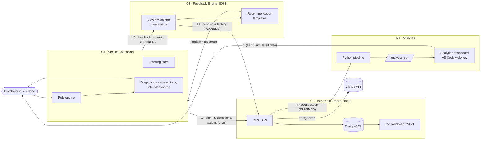
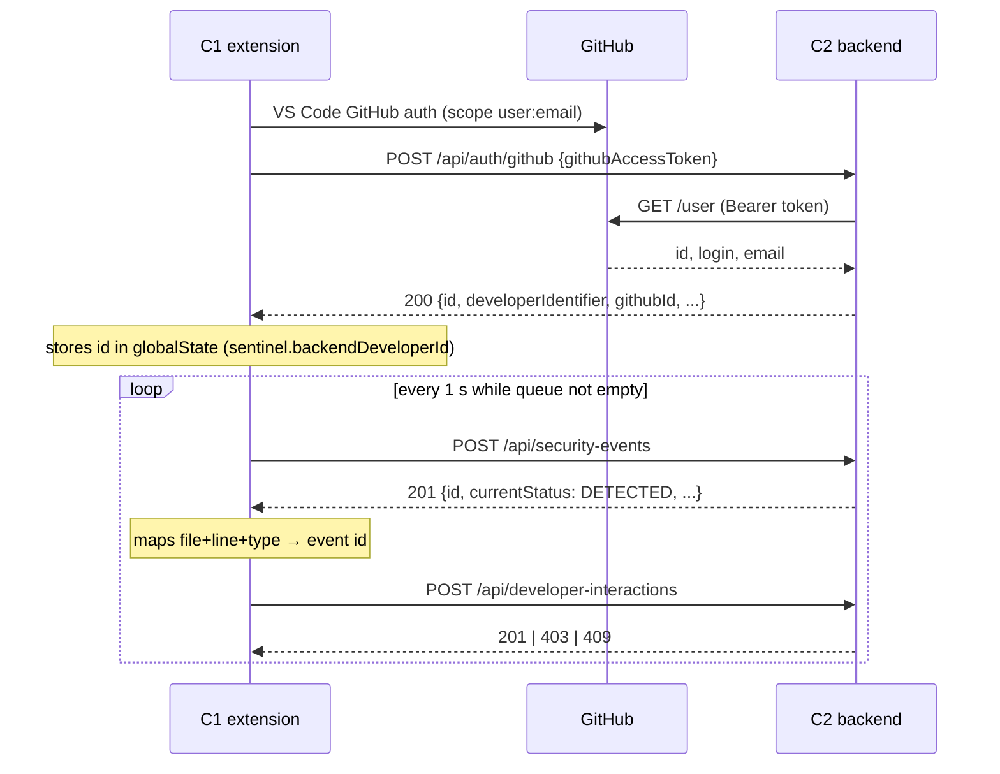
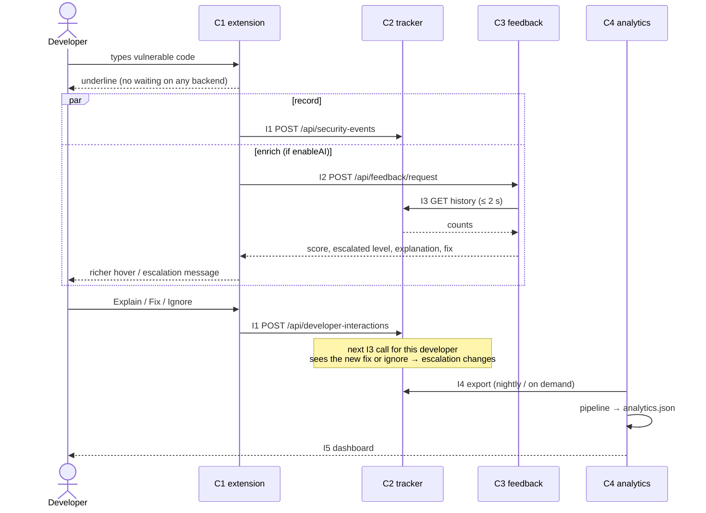

# Sentinel · Component Integration Guide

How the four Sentinel components connect: what each sends to each other, in what format,
over which channel, and what is still missing before the pipeline works end to end.

**Audience:** all four component owners and the supervisors.
**Status date:** 17 October 2026. Every "Today" statement below was checked against the
code on each component's branch on that date.

| Component | Owner | Folder | Branch | Runs as |
|---|---|---|---|---|
| C1 · Sentinel VS Code extension | M H S Perera | `sentinel/` | `main`, `hishen_dev` | VS Code extension |
| C2 · Developer Behaviour Tracker | R S D Sulakshana | `component-2-behaviour-tracker/` | `feature/component-2-backend-foundation` | Spring Boot :8080 + PostgreSQL; React dashboard :5173 |
| C3 · Intelligent Feedback Engine | D R Pathirage | `component-3-feedback-engine/` | `Component-3` | Spring Boot :8083 |
| C4 · Analytics and Dashboard | D S Gayanatha | `component-4-dashboard/` | `feature/analytics` | Python pipeline (batch) + VS Code extension (webview) |

---

## Contents

1. [The integrated system at a glance](#1-the-integrated-system-at-a-glance)
2. [Integration status matrix](#2-integration-status-matrix)
3. [Shared vocabulary: how the components disagree today](#3-shared-vocabulary-how-the-components-disagree-today)
4. [Identity: one developer, four ids](#4-identity-one-developer-four-ids)
5. [Interface I1 · C1 → C2: sign-in, detections, actions](#5-interface-i1--c1--c2-sign-in-detections-actions)
6. [Interface I2 · C1 → C3: feedback requests](#6-interface-i2--c1--c3-feedback-requests)
7. [Interface I3 · C3 ← C2: behaviour history](#7-interface-i3--c3--c2-behaviour-history)
8. [Interface I4 · C2 → C4: event export](#8-interface-i4--c2--c4-event-export)
9. [Interface I5 · C4 → developers: the analytics dashboard](#9-interface-i5--c4--developers-the-analytics-dashboard)
10. [End-to-end target flow](#10-end-to-end-target-flow)
11. [Data ownership and sources of truth](#11-data-ownership-and-sources-of-truth)
12. [Running the integrated system](#12-running-the-integrated-system)
13. [Failure handling across components](#13-failure-handling-across-components)
14. [Contract governance](#14-contract-governance)
15. [Integration testing](#15-integration-testing)
16. [Integration roadmap](#16-integration-roadmap)
17. [Open decisions](#17-open-decisions)

---

## 1. The integrated system at a glance



**The pipeline in one sentence.**
- **C1** detects and reports.
- **C2** remembers what the developer did.
- **C3** turns the event plus that memory into escalated, personalised feedback, which goes
  back to C1.
- **C4** turns C2's history into trends, forecasts, risk profiles and a research report.

## 2. Integration status matrix

| Id | From → To | Purpose | Transport | Today | Blocking gaps |
|---|---|---|---|---|---|
| **I1** | C1 → C2 | Sign-in, detections, developer actions | HTTP JSON, push | 🟢 Live | Repeated same-status actions get `409` and are lost (C2 TASKS P1-1) |
| **I2** | C1 → C3 | Ask for enriched feedback on a finding | HTTP JSON, request/response | 🔴 Broken | No REST API in C3 yet; wrong port; request and response shapes do not match (§6) |
| **I3** | C3 ← C2 | Behaviour history for escalation | HTTP JSON, pull | ⚪ Not built | Contract not agreed (C2 TASKS P3-1/P3-2) |
| **I4** | C2 → C4 | Real events to replace simulated data | NDJSON file or HTTP export, batch | ⚪ Not built | Contract not agreed; sessions and confidence not first-class in C2 (C2 TASKS P2-3, P3-3..P3-5) |
| **I5** | C4 → developer | Analytics dashboard | `analytics.json` → webview | 🟡 Live on simulated data | Depends on I4; planned merge into the C1 extension |
| — | C1 ↔ GitHub ↔ C2 | Identity | VS Code auth + GitHub `GET /user` | 🟢 Live | — |

Legend: 🟢 working · 🟡 working with limitations · 🔴 configured but fails · ⚪ not started.

## 3. Shared vocabulary: how the components disagree today

Each component defined its own enums. Every interface must translate between them. These
tables are the reference for those translations.

### 3.1 Severity

| Level | C1 `Severity` | C2 `Severity` | C3 `Severity` | C4 event `severity` |
|---|---|---|---|---|
| INFO | ✅ | ❌ | ✅ | ❌ |
| LOW | ✅ | ✅ | ✅ | ✅ |
| MEDIUM | ✅ | ✅ | ✅ | ✅ |
| HIGH | ✅ | ✅ | ✅ | ✅ |
| CRITICAL | ✅ | ✅ | ✅ | ❌ |

**Translations in force or proposed:**
- C1 → C2: `INFO → LOW`. This is live, in C1's `securityEventClient.ts`.
- C2 → C4: `CRITICAL → HIGH`. Proposed; C4's severity weights are LOW 1, MEDIUM 2, HIGH 3.
  The alternative is for C4 to add CRITICAL with weight 4. **Decision D1.**
- C1 → C3: identity, since both have all 5 levels.

### 3.2 Vulnerability type

| Type | C1 enum | C1 detects today | C2 | C3 enum and template | C4 simulator |
|---|---|---|---|---|---|
| `SQL_INJECTION` | ✅ | ✅ (17 patterns) | free text | ✅ | ✅ |
| `XSS` | ✅ | ✅ (18) | free text | ✅ | ✅ |
| `HARDCODED_SECRET` | ✅ | ✅ (22) | free text | ✅ | ✅ |
| `COMMAND_INJECTION` | ✅ | ❌ (main) | free text | ✅ | ✅ |
| `PATH_TRAVERSAL`, `MISSING_INPUT_VALIDATION`, `UNSAFE_DESERIALIZATION`, `WEAK_CRYPTOGRAPHY`, `INSECURE_AUTH`, `SENSITIVE_DATA_EXPOSURE` | ✅ | ❌ (main) | free text | ✅ | ❌ |
| OWASP Top 10 categories and SSRF (`hishen_dev`) | in progress | in progress | free text | ❌ | ❌ |

**Rules:**
- C1's `VulnerabilityType` enum is the **master list**. C2 stores whatever string C1 sends,
  so C2 never blocks a new type.
- C3 must keep its enum identical to C1's, or reject unknown types with a clear `400`.
- C4 must handle types beyond its simulator's four. Per-type features (`count_<type>`)
  should be built from the data, not from a fixed list.
- When `hishen_dev`'s OWASP rules merge, their type names must be added to C1's enum
  **first**, then to C3's enum and templates. **Decision D2.**

### 3.3 Developer actions

| C1 `DeveloperAction` | C2 `BehaviourAction` (I1) | C2 status | C3 (counts in `BehaviourHistory`) | C4 `action` (I4) |
|---|---|---|---|---|
| `DETECTED` | (creates the event) | `DETECTED` | `previousFindings` +1 | (the event itself) |
| `WARNING_SHOWN` | not sent | — | — | — |
| `EXPLANATION_VIEWED` | `OPEN` | `OPENED` | — | — |
| `SECURE_EXAMPLE_VIEWED` | `OPEN` | `OPENED` | — | — |
| `FIX_APPLIED`, `FIXED` | `FIX` | `FIXED` | `previousFixes` +1 | `FIXED` |
| `IGNORED` | `IGNORE` | `IGNORED` | `previousIgnores` +1 | `IGNORED` |
| `MARKED_FALSE_POSITIVE` | `IGNORE` (+ `metadata.extensionAction`) | `IGNORED` | `previousIgnores` +1? **D3** | `FALSE_POSITIVE` |
| `DISMISSED` | `DISMISS` | `IGNORED` | `previousIgnores` +1? **D3** | `DISMISSED` |
| `REOPEN` | `REOPEN` | `REOPENED` | — | — |

A false positive and a dismissal are **not** developer neglect. Counting them as "ignores"
in C3 would escalate warnings on developers who correctly reported a bad rule. That is
**decision D3**.

### 3.4 Other shared fields

| Field | C1 | C2 | C3 | C4 |
|---|---|---|---|---|
| Event id | `finding.id` (UUID, **regenerated on each analysis pass**); stable key = file + line + type | `security_events.id` (Long) | `eventId` (String, required) | `eventId` (String, UUID) |
| Session id | One per extension activation | On `behaviour_logs` only | `sessionId` (required) | `sessionId` |
| Confidence | 0.0–1.0 on every finding | Only inside `context_metadata` JSON | 0.0–1.0 (required) | 0.0–1.0 |
| Timestamps | ISO 8601 strings | `LocalDateTime` (no zone) | `Instant` | ISO 8601 |

**Timestamp rule.** C2 stores `LocalDateTime` without a zone, and C3 and C4 use instants.
Every interface that leaves C2 must state its zone. **Proposed: UTC on the wire everywhere
(`Z` suffix).** That is **decision D4**.

## 4. Identity: one developer, four ids

The same person has these ids in the components:

| Where | Id | Example | Source |
|---|---|---|---|
| GitHub | numeric id and login | `161543413`, `dulsh1` | GitHub |
| C1 local stores (records, learning) | GitHub login, else `sentinel.developerId` (`DEV001`) | `dulsh1` | `resolveDeveloperId()` in `extension.ts` |
| C1 → C2 calls | C2's numeric `developers.id` | `3` | `POST /api/auth/github` response, kept in `globalState` |
| C2 | `id` (Long), `developer_identifier` = login, `github_id` | `3`, `dulsh1`, `161543413` | Verified by C2 against GitHub |
| C1 → C3 calls (today) | The C1 local id (login or `DEV001`) | `dulsh1` | `AIEnhancedAnalyzerConfig.developerId` |
| C4 | String `developerId` | simulator: `dev-007` | — |

**Join rules for the integrated system:**
1. **C2 is the identity authority.** Its `developers` row is the one record of a developer.
2. **C2 ↔ C3:** C3 receives C1's local id, which is the GitHub login when signed in, so the
   join key is `developer_identifier`. C2 should expose a lookup by identifier (§7.3) so C1
   does not have to change.
   - GitHub logins are case-insensitive. Compare them case-insensitively, or normalise to
     lower case.
   - A `DEV001`-style fallback id (user not signed in) cannot be joined. C3 must then work
     without history.
3. **C2 → C4:** export a **pseudonym** (for example a salted hash of `developers.id`), never
   the login or email. **Decision D5.**
4. Nothing downstream of C2 should store GitHub emails.

**Trust.** C2 verifies identity only at sign-in. On later calls, `developerId` is asserted
by the client. This is accepted for the research prototype. A token-binding proposal is
tracked as C2 TASKS P5-1 and must be agreed with C1 before it is built.

## 5. Interface I1 · C1 → C2: sign-in, detections, actions

**Status: 🟢 Live. Contract: FROZEN.** C2 must not change the paths, required fields or
success codes. C1 is the client. Code: `sentinel/src/auth/authManager.ts`,
`sentinel/src/events/securityEventClient.ts` → `component-2-behaviour-tracker/backend`.

### 5.1 Sequence



### 5.2 Messages

**Sign-in.** Request `{"githubAccessToken": "<token>"}`. Response `DeveloperResponse`:
`id`, `developerIdentifier`, `githubId`, `githubUsername`, `email`, `createdAt`,
`updatedAt`.

**Detection** (`POST /api/security-events`, `201`):

| Field | From C1 | Rule in C2 |
|---|---|---|
| `developerId` | Backend id from sign-in | Required; developer must exist |
| `vulnerabilityType` | `finding.type` | Required, ≤ 255 |
| `severity` | `finding.severity` (`INFO → LOW`) | Required, enum |
| `fileName` | `finding.fileName` (full path) | Required, ≤ 500 |
| `lineNumber` | `finding.lineNumber` | Required, ≥ 0 |
| `message` | `finding.message` | Required |
| `detectedAt` / `timestamp` | not sent today | Optional; defaults to server time |

**Action** (`POST /api/developer-interactions`, `201`):

| Field | From C1 |
|---|---|
| `securityEventId` | The id returned by the detection call |
| `developerId` | Backend id |
| `action` | `OPEN` / `FIX` / `IGNORE` / `DISMISS` / `REOPEN` (table §3.3) |
| `sessionId` | C1 session id |
| `source` | `"VSCODE"` |
| `metadata` | JSON string `{"extensionAction": "...", "confidence": 0.92}` |

### 5.3 Delivery semantics (C1 side)

- The queue holds up to 500 items (oldest dropped first) and flushes every 1 s, sending in
  order. Detections always precede actions on the same finding.
- Each request has a 5 s timeout. A failure is retried up to **3 times, then dropped
  silently**. A dropped detection may be re-reported on a later analysis pass.
- With no backend id yet (not signed in, or the backend is down), items wait and are
  retried every 5 s.
- An action on a finding whose detection never reached C2 fails locally ("No backend
  security event") and is retried, then dropped.

**Consequence.** C2 must return `2xx` for **every action C1 sends in normal use**. Today a
repeated `OPEN` (explanation viewed, then secure example viewed) returns `409` and is lost.
This is fixed in C2 (TASKS P1-1) without any change to C1.

### 5.4 Allowed C1 → C2 changes

| Change | Allowed? |
|---|---|
| C2 adds an optional request field (for example `sessionId` on detections) | ✅ |
| C2 adds a response field | ✅ |
| C2 makes a field required, renames or removes one, changes a path or success code | ❌ |
| C1 starts sending an optional field C2 already accepts | ✅ with notice |
| C1 sends a new action or severity value | ❌ until C2 supports it |

## 6. Interface I2 · C1 → C3: feedback requests

**Status: 🔴 Configured in C1, does not work.** C1 calls it only when `sentinel.enableAI`
is `true` (default `false`), so nothing breaks today, but no feedback reaches developers
from C3.

### 6.1 What C1 sends today

`POST {sentinel.ifeUrl}/api/feedback/request`, where `ifeUrl` defaults to
`http://localhost:4000`. Timeout 4 s; the underline does not wait for it.

```jsonc
{
  "developerId": "dulsh1",              // C1 local id (GitHub login or DEV001), NOT C2's numeric id
  "sessionId": "…",
  "vulnerabilityType": "SQL_INJECTION",
  "severity": "HIGH",
  "confidence": 0.92,
  "codeSnippet": "…",
  "fileName": "/path/UserDao.java",
  "lineNumber": 42,
  "timestamp": "2026-10-17T10:15:00.000Z",
  "learningContext": { … }               // from C1's DeveloperLearningStore
}
```

What C1 expects back (it uses the result only if `status == "ok"`):

```jsonc
{
  "status": "ok",
  "contextualExplanation": "…",
  "personalizedFix": "…",
  "escalationMessage": "…",
  "feedbackLevel": "HIGH",
  "securityScore": 72,
  "aiGenerated": false
}
```

### 6.2 What C3 has today

- Port **8083**. **No controller.** The REST API is scheduled for 19 October.
- Input model `SecurityEvent`: `eventId`, `developerId`, `sessionId`, `vulnerabilityType`,
  `severity`, `confidence`, `fileName`, `lineNumber`, `detectedAt`.
- Input model `BehaviourHistory`: `developerId`, `previousFindings`, `previousFixes`,
  `previousIgnores`, `findingsByType`.
- Output model `FeedbackResponse`: `eventId`, `score`, `severity`, `message`.

### 6.3 Mismatches to resolve

| # | Mismatch | Proposed resolution | Owner |
|---|---|---|---|
| M1 | Port: C1 default 4000, C3 runs on 8083 | Change C1's `sentinel.ifeUrl` default to `http://localhost:8083` | C1 |
| M2 | Path: C1 calls `/api/feedback/request`; C3 has no endpoint | C3 implements exactly `POST /api/feedback/request` | C3 |
| M3 | C3 requires `eventId`; C1 sends none | C3 makes `eventId` optional (generate a UUID), or accepts C1's `finding.id` once C1 sends it | C3 (+ C1 optional) |
| M4 | C1 sends `timestamp`; C3 expects `detectedAt` | C3 accepts `timestamp` as an alias (C2 already does this with `@JsonAlias`) | C3 |
| M5 | C1 sends `codeSnippet` and `learningContext`; C3 ignores them | C3 accepts both as optional (`learningContext` as a free-form map); they may be used later for personalisation | C3 |
| M6 | Response shape differs completely | C3 adds a C1-facing response DTO with the fields C1 expects (§6.4), built from `SeverityScore` and `RecommendationTemplate` | C3 |
| M7 | Where `BehaviourHistory` comes from is undefined | C3 pulls it from C2 (I3) by `developerId` = login | C2 + C3 |

### 6.4 Proposed target contract for I2

Request: the C1 payload in §6.1, unchanged. **C1 needs no change except the port (M1).**

Response, mapped from C3's internals:

| C1 field | C3 source |
|---|---|
| `status` | `"ok"` on success; `"degraded"` if C2 history was unavailable but scoring still ran |
| `securityScore` | `SeverityScore.score` (0–100) |
| `feedbackLevel` | Severity after `FeedbackEscalationService.apply` |
| `escalationMessage` | Text explaining the escalation, for example "Escalated: you ignored this type 3 times"; empty if none |
| `contextualExplanation` | `RecommendationTemplate.title` + `guidance` (later: the personalised generator, due 17 October) |
| `personalizedFix` | `RecommendationTemplate.secureExample` (later: generator output) |
| `aiGenerated` | `false` while templates and rules are used |

Error behaviour: `400` for an invalid request (C1 treats it as no enrichment). C3 must answer
within C1's 4 s timeout, so its call to C2 (I3) needs a timeout of 2 s or less.

## 7. Interface I3 · C3 ← C2: behaviour history

**Status: ⚪ Not built.** Tracked as C2 TASKS P3-1 (agree) and P3-2 (build).

### 7.1 Direction

**C3 pulls from C2** when it receives an I2 request. C1 does not carry history to C3; C1's
`learningContext` is local and incomplete.

### 7.2 Mapping to C3's `BehaviourHistory`

| C3 field | Calculated in C2 as |
|---|---|
| `developerId` | `developer_identifier` (the login C3 received) |
| `previousFindings` | Number of the developer's security events (all time, or before a reference time; **D6**) |
| `previousFixes` | Distinct events with a `FIX` |
| `previousIgnores` | Distinct events with `IGNORE` (and `DISMISS`, **D3**) |
| `findingsByType` | Event counts grouped by `vulnerability_type` |

All counts are **distinct events**, the same semantics as C2's behaviour summary, so
repeated clicks cannot inflate escalation.

### 7.3 Proposed endpoint (C2)

```
GET /api/developer-behaviour/history?developerIdentifier={login}[&vulnerabilityType=SQL_INJECTION][&before=2026-10-17T10:15:00Z]

200
{
  "developerId": "dulsh1",
  "previousFindings": 12,
  "previousFixes": 7,
  "previousIgnores": 3,
  "findingsByType": { "SQL_INJECTION": 5, "XSS": 4, "HARDCODED_SECRET": 3 }
}

404  developer unknown → C3 scores with an empty history (no escalation) and returns status "degraded"
```

### 7.4 How C3's escalation uses it

| C3 rule | Uses |
|---|---|
| Base score + `min(5 × previous findings of this type, 15)` | `findingsByType[type]` |
| ≥ 2 previous ignores → one level up | `previousIgnores` |
| else ≥ 3 previous fixes → one level down | `previousFixes` |

These counts are all-type totals in C3 today. Whether ignores and fixes should be counted
**per vulnerability type** (closer to the TAF example "the same issue ignored four times")
is **decision D7**. If yes, C2 adds `ignoresByType` and `fixesByType`.

## 8. Interface I4 · C2 → C4: event export

**Status: ⚪ Not built.** C4 runs on its own simulator, and its README states that real
data will come in through the same event schema. Tracked as C2 TASKS P3-3..P3-5, plus a C4
ingest step.

### 8.1 Target record (C4's `events.jsonl`, one JSON object per line)

| C4 field | Type | From C2 | Note |
|---|---|---|---|
| `eventId` | string | `security_events.id` | Stringified |
| `developerId` | string | Pseudonym of `developers.id` | D5 |
| `sessionId` | string | Event's session (C2 TASKS P2-3), else the session of the first action | — |
| `vulnerabilityType` | string | `vulnerability_type` | C4 must accept types beyond its four |
| `severity` | `LOW`/`MEDIUM`/`HIGH` | `severity` | `CRITICAL → HIGH` unless C4 adds it (D1) |
| `confidence` | number | `context_metadata.confidence` of the first action | Null if unknown; C4 must allow null |
| `fileName` | string | `file_name` | Consider pseudonymising paths for real participants |
| `lineNumber` | int | `line_number` | — |
| `detectedAt` | ISO 8601 UTC | `detected_at` | D4 |
| `action` | `FIXED`/`IGNORED`/`DISMISSED`/`FALSE_POSITIVE` | The response chosen under D8 | — |
| `fixedAt` | ISO 8601 or null | Timestamp of the `FIX` log | Only when the action is `FIXED` |
| `responseTime` | seconds | `time_since_detection_seconds` of the chosen action | — |

**Action mapping** (C2 log → C4 `action`):
- `FIX` → `FIXED`;
- `IGNORE` with `metadata.extensionAction == MARKED_FALSE_POSITIVE` → `FALSE_POSITIVE`;
- other `IGNORE` → `IGNORED`;
- `DISMISS` → `DISMISSED`;
- `OPEN` and `REOPEN` are not outcomes.

**Decision D8:** which response represents the event.
- **(a)** The **first outcome** (fix, ignore, dismiss or false positive). This matches C4's
  simulator, where each detection has one action.
- **(b)** The **final** status.

Proposed: (a), plus an extra optional `finalStatus` field.

**Events with no outcome yet:** excluded, or exported with `action: null`. C4 must state
which it can handle (part of D8).

**Sessions** (`sessions.jsonl`, optional for C4): `{sessionId, developerId, startedAt}`,
where `startedAt` is the earliest event or action in the session.

### 8.2 Transport

- **Proposed:** `GET /api/export/c4/events?from=&to=` and `GET /api/export/c4/sessions`,
  returning `application/x-ndjson` and streamed. C4 saves the output as
  `data/raw/events.jsonl` and `sessions.jsonl`, and runs the pipeline unchanged.
- C4 then sets `meta.dataSource` to `"component2"` (already allowed by
  `analytics.schema.json`). Its "Simulated data" banner must switch off only in that case.
- I4 is a **batch** interface. C4 is an offline research pipeline; it does not need
  real-time data.

### 8.3 Repeat semantics must match

- C4 defines a repeat as the same (type, file) flagged in the previous 4 weeks. C2's planned
  repeat link (TASKS P2-1/P2-2) is recommended to use the **same definition**, so C2's
  dashboard and C4's analytics agree.
- C4 calculates its own `repeat_count` from the raw events, so I4 does not need to carry
  C2's repeat link. Including `repeatOfEventId` as an optional field allows a
  cross-check.

## 9. Interface I5 · C4 → developers: the analytics dashboard

**Status: 🟡 Live on simulated data.**

- The C4 pipeline writes `analytics.json`, validated against
  `ml/analytics.schema.json` (JSON Schema 2020-12).
- The **Sentinel Analytics** VS Code extension loads either the bundled sample or the file
  at `sentinelAnalytics.dataPath`, and renders seven tabs in a webview with a strict CSP
  and no network access.
- **Planned:** merge the dashboard into the C1 extension. That needs a decision on where
  it lives in C1's role-based UI (supervisor view at least), and on how C1 locates the
  latest `analytics.json` (**decision D9**).
- **Overlap:** three dashboards exist: C1's role dashboards, C2's web dashboard and C4's
  analytics.

| Dashboard | Shows | Audience |
|---|---|---|
| C1 (in editor) | Live findings, shifts, projects, users | Developers, supervisors, admins |
| C2 (web) | Operational record: events, lifecycle, behaviour summary per developer | Component owner, supervisors |
| C4 (in editor) | Research analytics: trends, forecasts, risk, correlations, report | Researchers, supervisors |

Rule: no dashboard re-implements another's analysis. C2 shows **measured** behaviour; C4
shows **modelled** results.

## 10. End-to-end target flow



**The research loop.**
1. A developer ignores warnings of a type.
2. C2 records the ignores.
3. C3 escalates the next warning of that type.
4. The developer's later behaviour is recorded by C2.
5. C4 measures whether behaviour improved after escalation.

This loop is what Sentinel's research question tests. It closes only when I1–I4 all work.

## 11. Data ownership and sources of truth

| Data | Source of truth | Copies / consumers | Note |
|---|---|---|---|
| Developer identity | **C2** `developers` | C1 (`globalState` id), C3 (login), C4 (pseudonym) | — |
| Security events and actions | **C2** PostgreSQL | C4 (export), C3 (counts) | — |
| Vulnerability lifecycle | **C2** | — | C1 shows its own local status |
| Detection rules, findings in the editor | **C1** | — | — |
| Per-developer learning (false-positive suppression, confidence tuning) | **C1** `*_learning.json` | — | Local to the developer's machine |
| C1 local vulnerability records, users, projects, shifts | **C1** JSON (Neon PostgreSQL on `hishen_dev`) | — | **Overlaps C2.** See below |
| Scoring and escalation rules, templates | **C3** | — | — |
| Analytics, forecasts, risk, report | **C4** `analytics.json` | C4 dashboard | Derived; never written back |

**Overlap to resolve (decision D10).**
- C1 stores its own vulnerability records with lifecycle status locally, and in Neon on
  `hishen_dev`. C2 stores the same detections centrally.
- Two stores can disagree. For example, C2 rejects an action but C1 marks the finding
  fixed locally.
- C4's README mentions taking data from "Sentinel's stored vulnerability records **and**
  Component 2".
- **Proposal:**
  - C2 is the **only research data source**: C4 reads from C2 only.
  - C1's local and Neon records serve C1's own UI (shifts, supervisor views) and are not
    used for research analysis.
  - Agreed by C1 and C4 owners.

## 12. Running the integrated system

### 12.1 Ports and processes

| Process | Port | Start command | Needs |
|---|---|---|---|
| PostgreSQL | 5432 | system service / Docker | — |
| C2 backend | 8080 | `cd component-2-behaviour-tracker/backend && mvn spring-boot:run` | PostgreSQL, `DB_USERNAME`/`DB_PASSWORD`, internet for GitHub |
| C3 engine | 8083 | `cd component-3-feedback-engine && mvn spring-boot:run` | Java 21; C2 (once I3 exists) |
| C2 dashboard | 5173 | `cd component-2-behaviour-tracker/frontend && npm run dev` | C2 backend |
| C1 extension | — | F5 from the repo root (`🛡 Launch Sentinel Extension`) | C2; C3 if `enableAI` |
| C4 pipeline | — | `cd component-4-dashboard/ml && .venv/bin/python -m src.pipeline` | Python 3.12; C2 export (once I4 exists) |
| C4 dashboard | — (preview 5173) | F5 in `component-4-dashboard/extension` | `analytics.json` |

**Port conflict.** The C2 dashboard and the C4 browser preview both use Vite's 5173. Run one
at a time, or give the C4 preview another port.

### 12.2 Start order

1. PostgreSQL.
2. C2 backend: check `GET http://localhost:8080/`.
3. C3: check that it starts on 8083.
4. C1 extension, with these settings:
   - `sentinel.backendUrl = http://localhost:8080`;
   - `sentinel.enableAI = true`;
   - `sentinel.ifeUrl = http://localhost:8083` (until M1 is fixed).

   Then sign in with GitHub.
5. C2 dashboard (optional).
6. C4: export from C2, run the pipeline, open the dashboard.

### 12.3 Branches

The components live on different branches today. Integration testing needs them on **one
branch**:
1. Each owner merges their component into `dev` through a pull request.
2. Integration tests run on `dev`.
3. `dev` is merged into `main` for milestones.

Each pull request touches only its own component's folder, plus agreed shared files.

## 13. Failure handling across components

| Failure | Who notices | Required behaviour |
|---|---|---|
| C2 down | C1 | Queue and retry (live). Detection and editor UX keep working. Events older than the queue limit or past 3 retries are lost; this is accepted for the prototype and recorded as a data-completeness risk. |
| C2 rejects an action (`4xx`) | C1 | Dropped after retries. **C2 must not reject normal C1 traffic** (§5.3). |
| GitHub down at sign-in | C2 → C1 | `502`. C1 keeps events queued until sign-in succeeds. |
| C3 down or slow | C1 | 4 s timeout; show rule-based hover without enrichment (live). |
| C2 down when C3 needs history | C3 | Score without history (no escalation), `status: "degraded"`, answer within C1's timeout. |
| Developer unknown to C2 (`DEV001` fallback) | C3 | Same as above. |
| Export missing or invalid for C4 | C4 | Schema validation fails loudly. The dashboard falls back to the sample, with a warning (live). |
| Unknown vulnerability type | C3 / C4 | C3: `400` with a clear message, or a generic template. C4: handle as its own category. Never crash. |

## 14. Contract governance

1. **Each interface has one owner of the server side.**

   | Interface | Server-side owner |
   |---|---|
   | I1 | C2 |
   | I2 | C3 |
   | I3 | C2 |
   | I4 | C2 (producer); C4 owns the schema |
   | I5 | C4 |

2. **Changes are additive by default:** new optional fields and new endpoints. A breaking
   change (rename, remove, newly required field, path or status code change) needs:
   - written agreement from every consumer's owner;
   - a transition period where both forms work;
   - an update to this document in the same pull request.
3. **I1 is frozen** (§5.4).
4. **Shared enums** follow §3. C1's `VulnerabilityType` is the master list.
5. **Where contracts live:**
   - This document holds the overview.
   - Each server keeps the detailed contract next to its code: C2 in
     `component-2-behaviour-tracker/backend/README.md`, C3 in its README, C4 in
     `ml/analytics.schema.json` and `ml/README.md`.
   - Agreed new contracts are recorded in `component-2-behaviour-tracker/docs/contracts/`
     (I3, I4) or the C3 folder (I2).
6. **Decisions** (§17) are recorded with date and owners. An open decision blocks the
   interface that depends on it.

## 15. Integration testing

| Level | What | Where |
|---|---|---|
| Contract tests (each server) | Request validation and response shape for every interface it serves | C2: MockMvc tests (exist for I1); C3: to be added with the REST API; C4: `test_export.py` / `sample.test.ts` (exist for I5) |
| Consumer checks | C1's payloads against C2's DTO validation; C4's ingest against a real C2 export sample | Fixture files shared in the PR that introduces the interface |
| End-to-end script | Detect → open → open again → ignore → fix, through the real extension; verify C2 rows, C3 escalation, C4 export | C2 TASKS P1-4 (`docs/e2e-check.md`), extended per interface |
| Escalation loop | Ignore the same type N times; check that C3's level rises at the agreed threshold | After I2 + I3 |
| Data completeness | Send N scripted events and actions; compare C2 counts and C4 export counts | C2 TASKS P4-3 |

Each test records the commit hashes of all components involved.

## 16. Integration roadmap

| Step | Interface | Work | Owners | Depends on |
|---|---|---|---|---|
| 1 | I1 | Accept same-status actions (TASKS P1-1); E2E check (P1-4) | C2 | — |
| 2 | I2 | C3 REST API at `POST /api/feedback/request` with the C1-facing response (M2–M6) | C3 | C3 milestone (19 October) |
| 3 | I2 | Change `sentinel.ifeUrl` default to 8083 (M1) | C1 | Step 2 |
| 4 | I3 | Agree (D3, D6, D7) and build the history endpoint (TASKS P3-1/P3-2); C3 calls it | C2, C3 | Step 2 |
| 5 | I1 | Optional `sessionId` on detections (TASKS P2-3; C1 sends it when ready) | C2, C1 | — |
| 6 | I4 | Agree the export (D1, D4, D5, D8) and build it (TASKS P3-3..P3-5); C4 ingest + `dataSource: "component2"` | C2, C4 | Step 5 |
| 7 | — | Resolve D10 (single research source) | C1, C2, C4 | — |
| 8 | I5 | Embed the C4 dashboard in C1 (D9) | C4, C1 | Step 6 |
| 9 | All | Merge all components to `dev`, run §15 end to end, merge to `main` | All | Steps 1–8 |

## 17. Open decisions

| Id | Question | Proposed answer | Decided by |
|---|---|---|---|
| D1 | How is `CRITICAL` represented in C4? | C4 adds `CRITICAL` (weight 4); until then, export as `HIGH` | C4, C2 |
| D2 | Type names for the OWASP rules on `hishen_dev` | Add them to C1's enum first, then C3's enum and templates | C1, C3 |
| D3 | Do dismissals and false positives count as "ignores" for escalation? | No. Count only `IGNORE` without false-positive metadata | C3, C2 |
| D4 | Timestamp zone on the wire | UTC, ISO 8601 with `Z` | All |
| D5 | Developer id in exports | Salted hash of `developers.id`; no login or email | C2, C4, supervisor |
| D6 | "Previous" in C3's history: before the current event, or all time? | Before the current detection time (`before` parameter) | C3, C2 |
| D7 | Per-type or total ignores and fixes for escalation | Per type (matches the TAF example) | C3 |
| D8 | Which response represents an event in C4: first or final? Events with no response? | First outcome, plus optional `finalStatus`; exclude events with no outcome | C4, C2 |
| D9 | Where the C4 dashboard lives inside C1 | Supervisor dashboard tab; path to `analytics.json` from a setting | C1, C4 |
| D10 | Single research data source | C2 only; C1's local and Neon records serve C1's UI | C1, C2, C4, supervisor |

When a decision is made, change its row to "Decided (date): …" and update the sections
that reference it.
